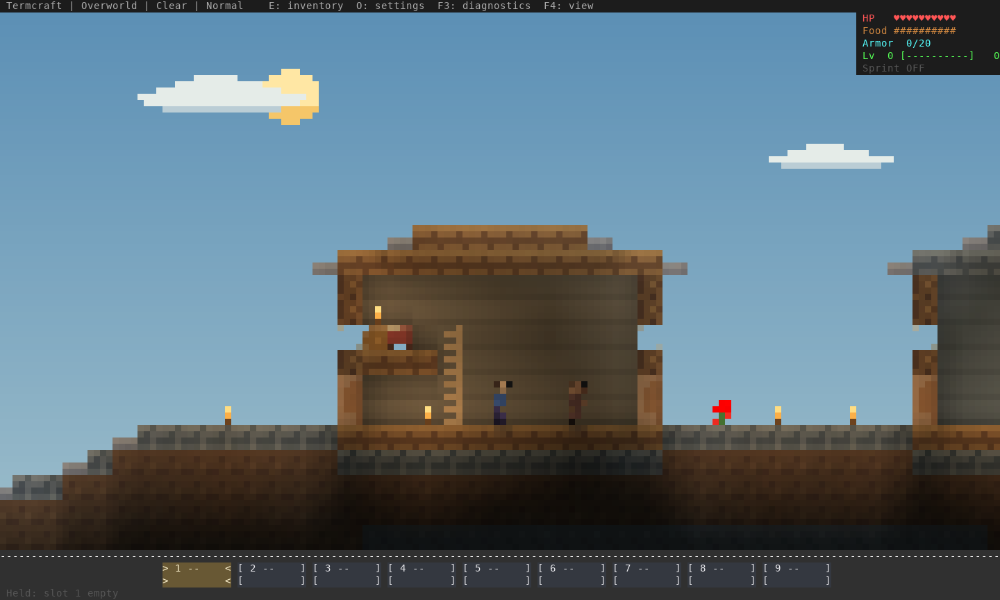

<div align="center">
  <h1>termcraft</h1>
  <p><strong>Survive, build and explore a block world in your terminal. Bring friends over SSH.</strong></p>
  <p>
    <a href="https://pagel-s.github.io/termcraft/"></a>
    <a href="https://github.com/pagel-s/termcraft/tree/beta/terminal-reborn"></a>
    <a href="https://github.com/pagel-s/termcraft/releases"></a>
    <a href="https://www.rust-lang.org/"></a>
  </p>
  <p>
    <a href="docs/installation.md">Play</a> ·
    <a href="docs/gameplay.md">Controls</a> ·
    <a href="docs/multiplayer.md">Co-op</a> ·
    <a href="docs/design/world-atlas-2026-10-15/README.md">World gallery</a> ·
    <a href="RELEASE_NOTES.md">Release notes</a>
  </p>
</div>

> Unofficial fan project. Not affiliated with Mojang or Microsoft.
>
> **Terminal Reborn is the next beta in development.** These changes are on
> `beta/terminal-reborn`; the published `0.1.0` release is the older alpha.
> Development binaries still report `0.1.0`. The beta has not been published.



## A survival world, adapted to 2D

Gather wood, craft tools, build a shelter and survive the night. Explore caves and
villages, smelt better equipment, cross the Nether, find the stronghold and face
the Ender Dragon. Termcraft adapts that survival progression to a side-on terminal
world, with shaped terrain, room cutaways and distinct creature silhouettes.

The development build includes:

- **Terminal pixel art:** coordinated blocks, items and creatures, supported
  lights, cave shadows and three selectable color views.
- **Movement and physics refinements:** walking and sprinting, variable-height
  jumps, ladders, ledges, shaped-block collision, swimming and animal shore escape.
- **Survival and building:** inventory and recipe book, manual crafting, explicit
  furnace slots, storage, farming, boats, weather, flowing water and lava.
- **Three dimensions:** procedural Overworld, Nether and End; connected villages,
  dungeons, strongholds, fortresses, working portals and a revised dragon encounter.
- **Co-op for up to eight:** independent inventories and dimension travel,
  shared terrain and combat, saved reconnect profiles and joining over SSH.
- **Lantern Run:** a separate combat, traversal and bridge-building route for a
  focused first session.

[Browse the environments and structures](docs/design/world-atlas-2026-10-15/README.md)
or [read the changes since the alpha](docs/beta-release-notes.md).
Gallery scenes use the actual renderer with staged camera/actor positions;
they are not recordings of manual play.

## Play the development build

**Without Rust:** download your platform's archive from a successful
[Native development artifacts run](https://github.com/pagel-s/termcraft/actions/workflows/native-artifacts.yml)
on `beta/terminal-reborn`. GitHub may require sign-in. Extract the artifact ZIP,
then the game archive inside it, keeping all files together.

| Platform | Artifact target | Start Lantern Run |
| --- | --- | --- |
| Linux, Intel/AMD 64-bit | `x86_64-unknown-linux-gnu` | `./play.sh` |
| Windows, Intel/AMD 64-bit | `x86_64-pc-windows-msvc` | `.\PLAY.cmd` in Windows Terminal |
| macOS, Apple silicon | `aarch64-apple-darwin` | `./PLAY.command` |
| macOS, Intel | `x86_64-apple-darwin` | `./PLAY.command` |

For classic survival run `./termcraft` on Linux/macOS or `.\termcraft.exe` on
Windows. macOS development builds are unsigned. See [installation](docs/installation.md)
for terminal requirements and platform details.

**From source:** install [Rust 1.88 or newer](https://rustup.rs/), then:

```sh
git clone --branch beta/terminal-reborn https://github.com/pagel-s/termcraft.git
cd termcraft
cargo build --release --locked
./target/release/termcraft trial
```

On Windows, use `.\target\release\termcraft.exe trial`. Omit `trial` for classic
survival. `cargo install --path . --locked` installs this checkout into Cargo's bin directory.

`cargo install termcraft` installs the published alpha, which predates these
changes. Linux users can also find the [AUR package](https://aur.archlinux.org/packages/termcraft);
check its version before comparing it with the development branch.

## Controls

Start with a true-color terminal, a monospace font and a window around **120×40**
or larger. Mouse support is recommended.

| Action | Control |
| --- | --- |
| Walk | Hold `A` / `D` or left/right arrow |
| Sprint | Tap, release, then quickly hold the same direction |
| Jump / swim up | `W`, `Up` or `Space` |
| Sneak | `X` toggles; `Shift` holds |
| Mine / attack | Left mouse button |
| Place / interact | Right mouse button; `F` uses the hovered block |
| Inventory / crafting | `E` |
| Select hotbar slot | `1`–`9` |
| Drop one / stack | `V` / `Shift+V` |
| Zoom in / out | `=` or `+` / `-` |
| Cycle Overview / Wide / Detail | `F4` |
| Settings / diagnostics | `O` / `F3` |
| Close UI / save and quit | `Q` or `Esc` |

**Detail is the default for a fresh setup.** Your saved view takes precedence;
use `-` for more world context or `=` to return to Detail. Resizing the terminal
keeps the selected view, and terminal font size is independent of it. Reliable
double-tap sprint needs directional key-release events; F3 shows `keys:release` or the repeat-only fallback.
See [gameplay](docs/gameplay.md) for crafting, furnaces and portal use.

## Play with friends

Use matching development builds. Start a server and join from separate terminals:

```sh
termcraft server
termcraft client --player alice
termcraft client --player bob
```

From another computer, join through an existing SSH account:

```sh
termcraft join user@host --player alice
```

Run the server on that host first, with the game port bound to loopback. SSH
accounts, OpenSSH and forwarding permission must already be available. Local
co-op uses plain TCP; SSH provides the protected remote transport.
See [co-op](docs/multiplayer.md) and [SSH setup](docs/distribution.md#join-through-ssh).

## Saves and current limits

The game autosaves in your user data directory:

- Linux: `$XDG_DATA_HOME/termcraft/saves`, or `~/.local/share/termcraft/saves`.
- macOS: `~/Library/Application Support/termcraft/saves`.
- Windows: `%APPDATA%\termcraft\saves`.

`TERMCRAFT_SAVE_DIR` overrides the location. Back up the **whole save directory**,
including hidden checkpoint files, before upgrading. Newer saves cannot be
opened by older builds. Existing terrain is preserved; new village layouts,
ore distribution and terrain details require fresh chunks.

This remains a development build. Terminal input/presentation, long human co-op
sessions and complete survival progression need broader playtesting. Fluid
volume is source-based, and furnaces currently use each player's session rather
than independent shared storage. See [save recovery](docs/world-format.md)
and [release notes](docs/beta-release-notes.md).

## Development and feedback

```sh
cargo test --locked
cargo clippy --all-targets --locked -- -D warnings
./scripts/release_smoke.sh
```

[Developer guide](docs/developer.md) · [Release checklist](RELEASE_CHECKLIST.md) ·
[Supported content](docs/supported-content.md) · [Media credits](docs/media-credits.md)

Report bugs through [GitHub issues](https://github.com/pagel-s/termcraft/issues)
or `pagel.sebastian.1@gmail.com`. Include build, OS, terminal and reproduction steps.

[The original alpha highlight video](https://youtu.be/kR986Xqzj7E) shows the older
release; the linked galleries show the development artwork.
