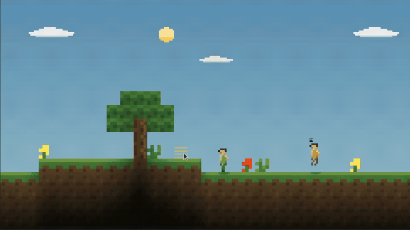

<div align="center">
  <h1>termcraft</h1>
  <p><strong>Survive, build and explore a block world in your terminal. Bring friends over SSH.</strong></p>
  <p>
    <a href="https://pagel-s.github.io/termcraft/"></a>
    <a href="https://github.com/pagel-s/termcraft/releases"></a>
    <a href="https://www.rust-lang.org/"></a>
  </p>
  <p>
    <a href="docs/installation.md">Play</a> ·
    <a href="docs/gameplay.md">Controls</a> ·
    <a href="docs/multiplayer.md">Co-op</a> ·
    <a href="RELEASE_NOTES.md">Release notes</a>
  </p>
</div>

> Unofficial fan project. Not affiliated with Mojang or Microsoft.
>
> **Termcraft `0.2.0-beta.1` — beta prerelease.**
> Download the game from [Releases](https://github.com/pagel-s/termcraft/releases).



Watch the full video ·
[Music and media credits](docs/media-credits.md)

## A survival world, adapted to 2D

Gather wood, craft tools, build a shelter and survive the night. Explore caves and
villages, smelt better equipment, cross the Nether, find the stronghold and face
the Ender Dragon. Termcraft adapts that survival progression to a side-on terminal
world, with shaped terrain, room cutaways and distinct creature silhouettes.

The beta includes:

- **Terminal pixel art:** coordinated blocks, items and creatures, supported
  lights, cave shadows and three selectable color views.
- **Movement and physics refinements:** walking and sprinting, variable-height
  jumps, ladders, ledges, shaped-block collision, swimming and animal shore escape.
- **Survival and building:** inventory and recipe book, manual crafting, explicit
  furnace slots, storage, farming, boats, weather, flowing water and lava.
- **Three dimensions:** procedural Overworld, Nether and End; connected villages,
  dungeons, strongholds, fortresses, working portals and a revised dragon encounter.
- **Co-op for up to eight:** independent inventories and dimension travel,
  shared terrain, PvP combat, player chat, saved reconnect profiles and joining over SSH.
- **Lantern Run:** a separate combat, traversal and bridge-building route for a
  focused first session.

[Supported content](docs/supported-content.md) · [Release notes](RELEASE_NOTES.md)

## Play the beta

**Without Rust:** download your platform's `0.2.0-beta.1` archive from
[Releases](https://github.com/pagel-s/termcraft/releases). Extract the game archive,
keeping all files together. Development builds are also available from successful
[Native artifacts runs](https://github.com/pagel-s/termcraft/actions/workflows/native-artifacts.yml);
those downloads require GitHub sign-in and an additional artifact ZIP extraction.

| Platform | Artifact target | Start Lantern Run |
| --- | --- | --- |
| Linux, Intel/AMD 64-bit | `x86_64-unknown-linux-gnu` | `./play.sh` |
| Windows, Intel/AMD 64-bit | `x86_64-pc-windows-msvc` | `.\PLAY.cmd` in Windows Terminal |
| macOS, Apple silicon | `aarch64-apple-darwin` | `./PLAY.command` |
| macOS, Intel | `x86_64-apple-darwin` | `./PLAY.command` |

For classic survival run `./termcraft` on Linux/macOS or `.\termcraft.exe` on
Windows. macOS archives are unsigned. See [installation](docs/installation.md)
for terminal requirements and platform details.

**From source:** install [Rust 1.88 or newer](https://rustup.rs/), then:

```sh
git clone https://github.com/pagel-s/termcraft.git
cd termcraft
cargo build --release --locked
./target/release/termcraft trial
```

On Windows, use `.\target\release\termcraft.exe trial`. Omit `trial` for classic
survival. `cargo install --path . --locked` installs this checkout into Cargo's bin directory.

Rust users can install the beta with
`cargo install termcraft --version 0.2.0-beta.1 --locked`.
See [package-manager channels](docs/distribution.md#package-manager-channels)
for Homebrew, WinGet and APT. Linux users can also find the
[AUR package](https://aur.archlinux.org/packages/termcraft); check its version.

## Controls

Start with a true-color terminal, a monospace font and a window around **120×40**
or larger. Mouse support is recommended.

| Action | Control |
| --- | --- |
| Walk | Hold `A` / `D` or left/right arrow |
| Sprint | Tap, release, then quickly hold the same direction |
| Jump / swim up | `W`, `Up` or `Space` |
| Sneak | `X` toggles; `Shift` holds |
| Mine / attack | Left mouse button |
| Place / interact | Right mouse button; `F` uses the hovered block |
| Inventory / crafting | `E` |
| Select hotbar slot | `1`–`9` |
| Drop one / stack | `V` / `Shift+V` |
| Zoom in / out | `=` or `+` / `-` |
| Cycle Overview / Wide / Detail | `F4` |
| Settings / diagnostics | `O` / `F3` |
| Player chat (co-op) | `T`; `Enter` sends, `Esc` closes |
| Close UI / save and quit | `Q` or `Esc` |

**Detail is the default for a fresh setup.** Your saved view takes precedence;
use `-` for more world context or `=` to return to Detail. Resizing the terminal
keeps the selected view, and terminal font size is independent of it. Reliable
double-tap sprint needs directional key-release events; F3 shows `keys:release` or the repeat-only fallback.
See [gameplay](docs/gameplay.md) for crafting, furnaces and portal use.

## Play with friends

Use matching beta builds. Start hosting and playing in one terminal:

```sh
termcraft host
```

The host starts the server and joins automatically. Press **T** to see the join
address; friends on the same network run `termcraft client ADDRESS --player bob`.
Each terminal on one computer needs a different `--player` profile. **O** opens
shared settings for the host. Dying does not stop the server; quitting `host` does.

Follow the **[multiplayer setup guide](docs/multiplayer.md)** for one computer,
one network or separate networks, with connection checks and troubleshooting.
The **[safe hosting guide](docs/hosting.md)** provides a rootless Linux container
launcher, restricted private-network access, backups, restore and updates.
Native archives include both guides and the hosting files. For an existing
administrator-provisioned SSH host, see [SSH joining](docs/distribution.md#join-through-ssh).

## Saves and current limits

The game autosaves in your user data directory:

- Linux: `$XDG_DATA_HOME/termcraft/saves`, or `~/.local/share/termcraft/saves`.
- macOS: `~/Library/Application Support/termcraft/saves`.
- Windows: `%APPDATA%\termcraft\saves`.

`TERMCRAFT_SAVE_DIR` overrides the location. Back up the **whole save directory**,
including hidden checkpoint files, before upgrading. Newer saves cannot be
opened by older builds. Existing terrain is preserved; new village layouts,
ore distribution and terrain details require fresh chunks.

This is a beta prerelease. Terminal input/presentation, long human co-op
sessions and complete survival progression need broader playtesting. Fluid
volume is source-based. Placed furnaces share their contents and progress across
players. See [save recovery](docs/world-format.md)
and [release notes](RELEASE_NOTES.md).

## Feedback

Report bugs through [GitHub issues](https://github.com/pagel-s/termcraft/issues)
or `pagel.sebastian.1@gmail.com`. Include build, OS, terminal and reproduction steps.

[Supported content](docs/supported-content.md) · [Media credits](docs/media-credits.md)
