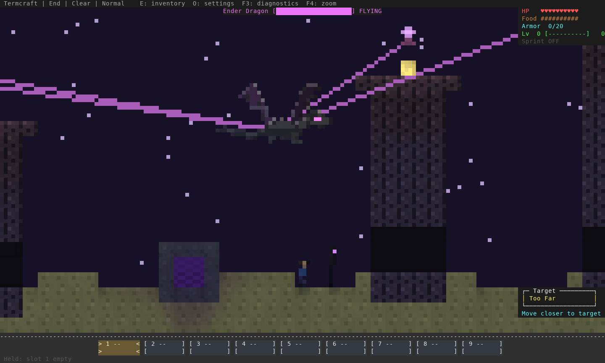
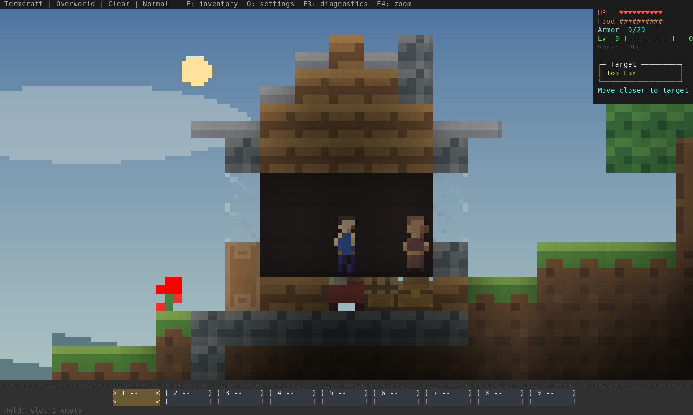
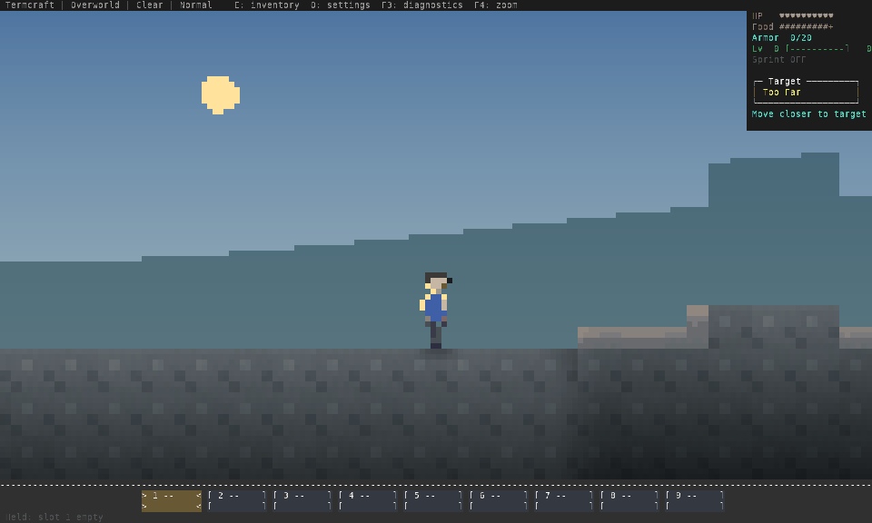

# 2D terrain, catalog and physics review — 12 October 2026

[Open the searchable review gallery](index.html). These are captures of the
implemented terminal renderer using temporary worlds, not concept images.
The candidate remains a development build. Human approval of art and gameplay
feel, a full survival playthrough and native Windows/macOS qualification remain open.

## Review rounds and corrections

1. **Terrain proportions and traversal:** inspected the actual generated End,
   rather than the earlier hand-built four-block pillar fixture. Fresh towers now
   have five-block upper columns, seven-block crowns, 11–16-block heights and
   continuous three-block walking tunnels across chunk seams. The boss camera
   shows more of the arena. Slabs/stairs use explicit half-block geometry shared
   by movement, occlusion and contact shadows. Farm animals use the common swept
   solver with figure-sized bodies. Sub-tick releases retain the last displayed
   position; small corrections settle instead of resetting the camera immediately.
2. **Complete catalog:** reviewed all 135 item types in actual world drops and
   inventory pages, and 97 representative block/state samples at both pixel-view
   resolutions. Items now share one atlas in world drops, hotbar, inventory and
   crafting output. Redstone torch/button/repeater states, piston directions and
   filled End frames are differentiated. Raw/cooked food, buckets and potion
   palettes were corrected. Family silhouettes share deliberate conventions;
   not every item has a unique silhouette.
3. **Picture/rule agreement:** corrected false dark background columns beneath
   floating props, dropped-item/orb landing heights and terrain intersections for
   fast arrows/fireballs. Rays use actual slab/stair bounds, and block interaction
   accepts a reachable face instead of requiring a buried center. Dragon head,
   neck and torso receive hits where the figure is drawn; decorative wing/tail
   air no longer counts as a broad circular contact attack. End ambient fill
   improves dark-material readability without brightening Overworld caves or
   changing simulation light/spawn rules.
4. **Cross-world follow-up:** distinguished soil hydration, crop and Nether wart
   growth, and spawner species. Corrected a visible half-block gap below the hut
   ridge after slabs became physical half blocks. Fresh huts retain slab eaves
   with continuous full support beneath the ridge. The catalog fixture now places
   plants on valid soil, asserts that every sample survives placement and keeps
   blocks clear of HUD overlays. A HUD regression also received deterministic
   reachable terrain instead of depending on random spawn geometry.

Each round was followed by relevant regression checks and fresh captures. Existing
saved terrain/structures are preserved; fresh generation is needed to see the new
End towers and village roofs. Protocol **11** requires matching client/server builds;
progression remains **v7** and the package remains **0.1.0-dev**.

## Scope and visual evidence

The gallery retains **86 complete frames**: 52 block/inventory/drop catalog frames,
27 entity/pose/lighting frames at 120×40, 160×48 and 200×60, three generated-End
frames, and four world scenes. All 135 `ItemType::ALL` values are covered. The
97 block samples cover every non-air enum variant with representative boolean,
fluid, growth, hydration and power states; they do not enumerate every timer/value
combination. Fluid levels retain the current full-cell presentation and simulation.





The village and End arena use actual seeded generation. Entity groups, cave and
Nether compositions are staged. `worlds-end.png` retains the earlier example's
small hand-built composition; **translation-end-arena-*.png** are the generated
terrain review. None is a completed boss encounter or survival campaign.



The course contains 168 incremental ANSI frames decoded in sequence, representing
56 simulation ticks sampled three times per tick. The player walks slabs → stairs
→ full blocks → half-block descent, then releases. The [trace](course.json) records
position, velocity and grounded state. GIF duration follows 20/10/20 ms per three
frames; PNGs retain unquantized captures. Rasterization uses 9×18 terminal cells
and nearest-neighbor scaling. This demonstrates the implemented course, not human
input latency or absence of every possible correction.

## Qualification

Exact source hashes, executable hash, timings and test scope are in
[the evidence report](../../assets/2d-refinement-2026-10-12.json).

- Stable and Rust 1.88: **599 unit tests**, all-target strict Clippy and formatting.
- Three real TCP regressions: contested resources/building/reconnect/restart,
  permissions/cancellation regressions and eight-player delayed/stalled
  reader behavior. The default soak is 12 seconds and is not a human co-op session.
- Native and co-op terminal fixtures: enhanced held input without repeated events,
  release braking, initial arrow input, focus-loss clearing, inventory/F3/F4 and
  terminal restoration.
- Real OpenSSH client against an encrypted temporary Paramiko endpoint: key/host
  checks, forwarding failures, reconnect/restart and dropped-link cleanup.
- Offline provider adapter tests, crate package verification, strict documentation
  build, plus extracted Linux native archive/runtime launch without Rust in PATH.
- Color-enabled renderer profile: 16 cases including 135 world-drop types. CPU
  composition/ANSI costs exclude simulation, kernel I/O, emulator, models and WAN.

The previous source checkpoint [27d7e54](https://github.com/pagel-s/termcraft/commit/27d7e54a48c3ff49f69115fceed6ab31f5bfdd7c)
passed [GitHub CI](https://github.com/pagel-s/termcraft/actions/runs/38213764088).
Current revision CI is reported separately from that historical checkpoint.

## Reproduce without user saves

```sh
env -u NO_COLOR cargo run --release --example material_review -- /tmp/tc-materials
env -u NO_COLOR cargo run --release --example entity_review -- /tmp/tc-entities
env -u NO_COLOR cargo run --release --example translation_review -- /tmp/tc-translation
env -u NO_COLOR cargo run --release --example pixel_review -- /tmp/tc-worlds
# Pillow is required only for the offline gallery builder.
python3 scripts/build_refinement_review.py /tmp/tc-materials /tmp/tc-entities \
  /tmp/tc-translation /tmp/tc-worlds /tmp/tc-review
env -u NO_COLOR cargo run --release --example render_profile
cargo test --locked
cargo clippy --all-targets --locked -- -D warnings
cargo test --locked --test multiplayer_tcp -- --ignored
```

## Remaining acceptance work

Repeat-only terminals still cannot report an actual key release during the initial
repeat delay. Real WAN reconciliation, fluid/boat behavior, bespoke combat/flight
animations, long projected shadows, larger multi-building villages and full survival
progression need further work/qualification. Contact shadows are bounded support
shadows. The End boss AI retains its existing flight/point-terrain behavior; this
pass aligns head/body damage regions, not the complete wing/tail flight volume.
Small-view and inventory icons are constrained by the terminal pixel grid.
