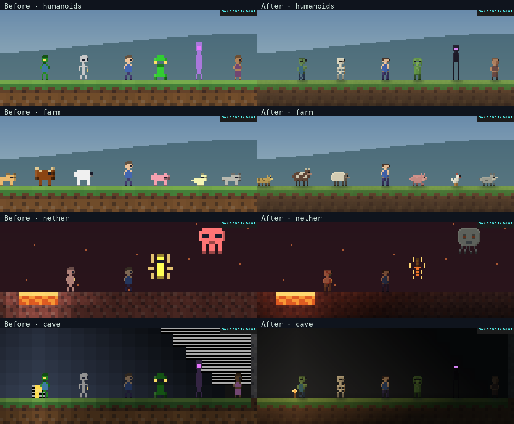
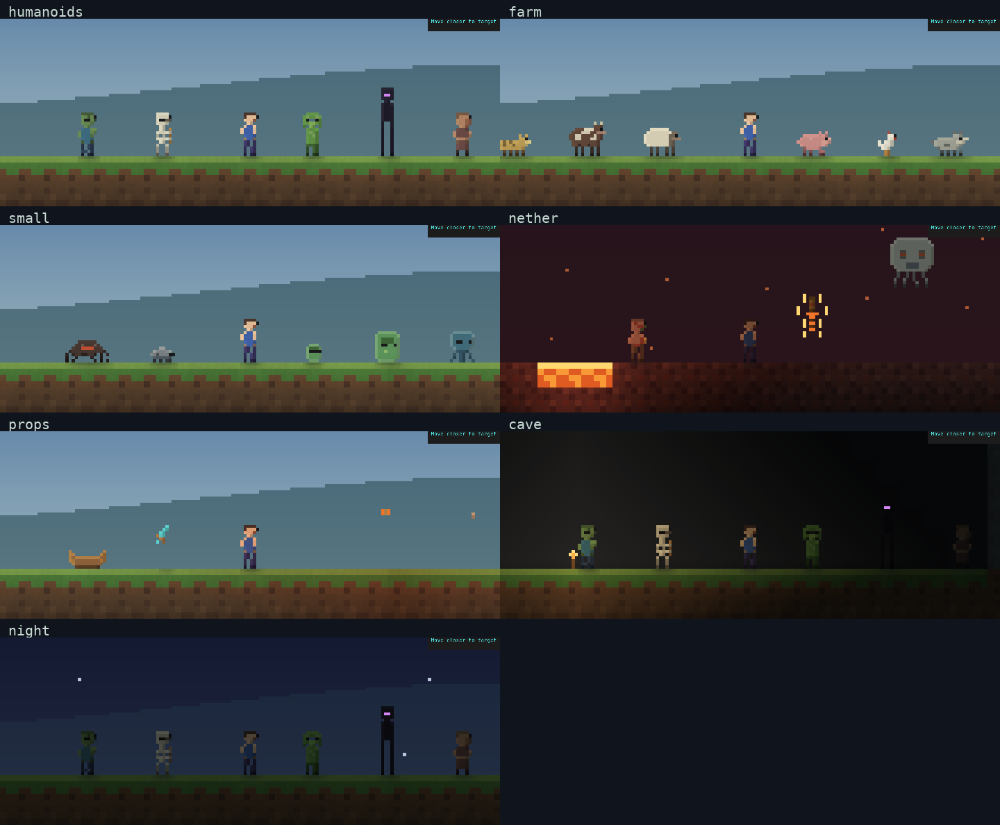

# Entity, proportion and lighting audit — 11 October 2026

This pass followed feedback that the first pixel candidate still had weak mobs,
proportions and shadows. Captures use the implemented renderer. They are staged
inspection fixtures, not concept images or a human survival playthrough.

## Findings and corrections

| Finding | Correction | Source |
| --- | --- | --- |
| Several animals shared the same generic body; some figures were stretched vertically. | Separate silhouettes for each species, native source proportions, feet aligned to world positions. Slime size and projectile overrides are retained. | `src/renderer/sprites.rs` |
| Endermen/dragon bodies were bright purple; charging ghasts could be mistaken for damage by a red-color heuristic. | Dark body palettes, bright identity pixels, explicit damage/alert flags. | `src/renderer/sprites.rs`, `src/renderer/terminal.rs` |
| Hard-coded clothing/fur colors escaped scene lighting; helmets also colored the face. | Shared per-pixel illumination, separate skin and helmet covering, visible wool/sheared and charged variants. | `src/renderer/shading.rs`, `src/renderer/sprites.rs` |
| Empty pixels in torches, windows and other objects retained oversized glyph fragments. | Compose the entire pixel background directly, then paint material and creature masks; remove the old glyph-upscale layer. | `src/renderer/sprites.rs`, `src/renderer/materials.rs` |
| Cave light changed in tile-sized bands; objects looked detached from ground. | Continuous lighting samples, restrained warm/ember/arcane light, bounded contact shadows clipped to exposed solid support. | `src/renderer/shading.rs`, `src/renderer/sprites.rs` |
| Strong texture contrast competed with characters; room edges lacked depth. | Quieter material palettes, detailed torches/glass/furniture, corner and room-contact shading. | `src/renderer/materials.rs` |
| Creatures could overpaint walls or overlap according to species list order. | Opaque terrain occlusion and a stable feet-based drawing order; controlled players remain legible on equal-height overlaps. | `src/renderer/sprites.rs` |
| Small-view downsampling discarded identity pixels. | Preserve eye pixels when combining source pixels; regression covers both pixel-view resolutions. | `src/renderer/sprites.rs` |

## Review images



The comparison uses the same staged geometry, positions, terminal size and clock.
Each column is reduced by the same nearest-neighbor factor. It is a software
rasterization of actual ANSI output, not a recording of the user's terminal.



Full-size after captures:

| Scene | 120×40 | 160×48 | 200×60 |
| --- | --- | --- | --- |
| humanoids | [120x40](after/humanoids-120x40.png) | [160x48](after/humanoids-160x48.png) | [200x60](after/humanoids-200x60.png) |
| farm | [120x40](after/farm-120x40.png) | [160x48](after/farm-160x48.png) | [200x60](after/farm-200x60.png) |
| small | [120x40](after/small-120x40.png) | [160x48](after/small-160x48.png) | [200x60](after/small-200x60.png) |
| nether | [120x40](after/nether-120x40.png) | [160x48](after/nether-160x48.png) | [200x60](after/nether-200x60.png) |
| props | [120x40](after/props-120x40.png) | [160x48](after/props-160x48.png) | [200x60](after/props-200x60.png) |
| night | [120x40](after/night-120x40.png) | [160x48](after/night-160x48.png) | [200x60](after/night-200x60.png) |
| cave | [120x40](after/cave-120x40.png) | [160x48](after/cave-160x48.png) | [200x60](after/cave-200x60.png) |
| poses | [120x40](after/poses-120x40.png) | [160x48](after/poses-160x48.png) | [200x60](after/poses-200x60.png) |
| farm_states | [120x40](after/farm_states-120x40.png) | [160x48](after/farm_states-160x48.png) | [200x60](after/farm_states-200x60.png) |

The first seven scene groups also have [before captures](before/entities.png).
The additional poses and farm-state scenes inspect crouching/held equipment,
damage, facing direction, charged creepers, sheared sheep and aggressive wolves.
All 26 creature/entity atlas kinds are covered by these scenes plus the
[End and generated-hut captures](worlds.png). Tiny projectiles and drops retain
small silhouettes; tool drops have class-specific shapes, other items use compact
icons. The close view has about eight square pixels per block at 160×48, four at
120×40. Small views inevitably lose detail; a terminal cell ratio near 1:2 is
needed for the intended proportions.

## Reproduce

```sh
env -u NO_COLOR cargo run --release --example entity_review -- /tmp/termcraft-entity-audit
python3 scripts/capture_terminal_art.py /tmp/termcraft-entity-audit /tmp/termcraft-entity-png
env -u NO_COLOR cargo run --release --example pixel_review -- /tmp/termcraft-world-audit
```

The examples create and remove disposable save roots. The converter requires
Pillow and DejaVu Sans Mono. It parses the renderer's ANSI subset, draws exact
half-cell rectangles and normal UI glyphs at 9×18 cells, and does not open a world.

## Scope and remaining uncertainty

Movement, network protocol 10, saves and gameplay light rules are unchanged by
this pass. Presentation lighting is a bounded approximation: it adds contact
shadows and terrain/room occlusion, not general 3D projected sunlight shadows.
Legacy full-tile furniture/stair/slab collision and some passive-mob collision
bounds still need reconciliation with finer geometry. A larger-village system,
bespoke attack/flight/equipment animations, HUD redesign, terminal font/platform
qualification and human acceptance of the art remain open.

Exact binary/source identities, checks and renderer timing are retained in
`docs/assets/art-audit-2026-10-11.json`. Performance measurements exclude terminal
presentation and network latency; screenshots do not establish smooth human play.
