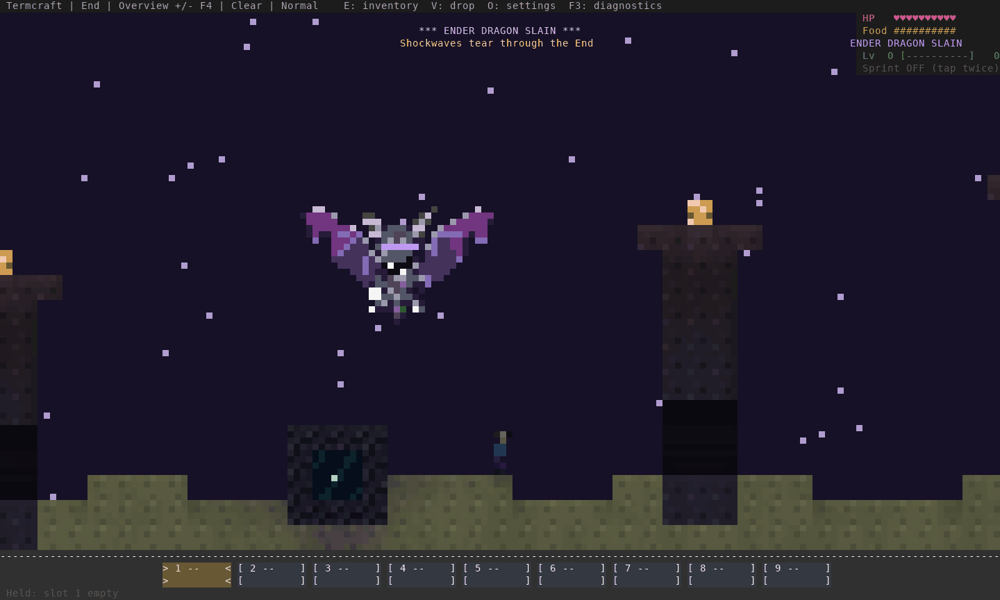
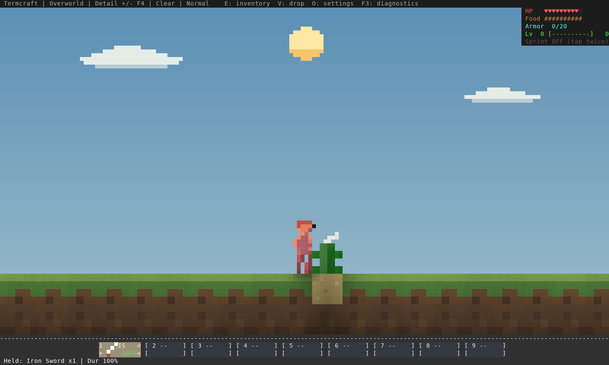
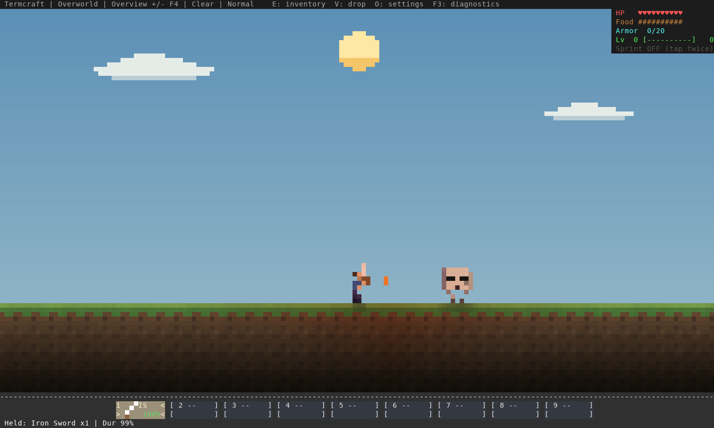
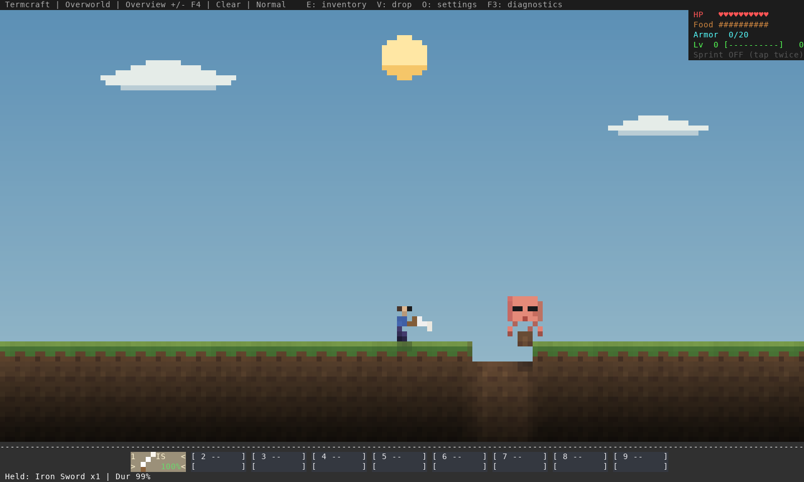
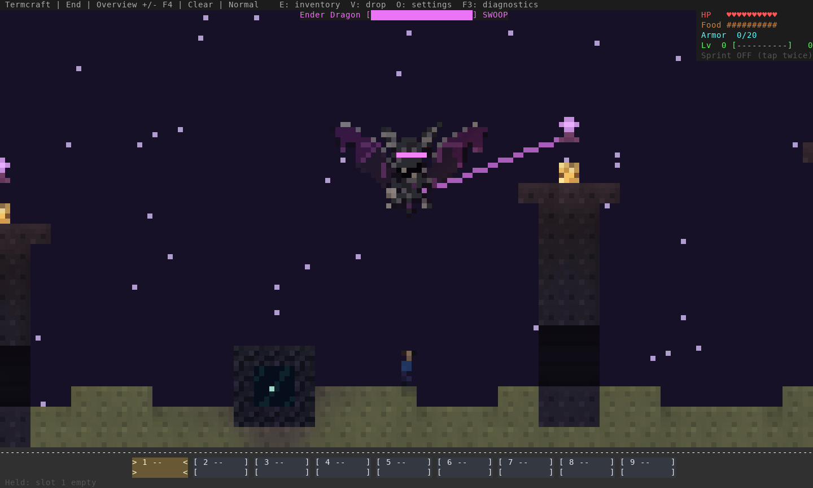
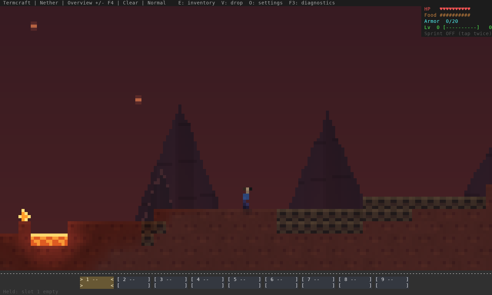

# Combat feedback and dragon finale — 17 October 2026

Actual Termcraft engine/renderer captures from source **4c5a9c6**, including fixes
in **734efd8** and save migration **2315025**. These use disposable staged worlds,
the normal damage/projectile/death paths and the game renderer. No concept images.

## Dragon finale

The staged kill triggers the real boss-death path. The original dragon artwork
and palette fracture into illuminated shards, with expanding shock fronts and a
light column over the actual return portal. The encounter camera stays in place
through the sequence; the world keeps simulating. Rewards/portal creation occur
once at death. Co-op snapshots carry the sequence and checkpoints retain its clock.
This GIF represents 20 simulation ticks per second; it is not a terminal FPS test
or evidence of a human completing the fight.

Full-resolution frames: [start](victory-000.png), [cracks](victory-018.png),
[burst](victory-036.png), [expansion](victory-060.png), [shards](victory-090.png),
[portal](victory-120.png), [finished](victory-140.png).

## Damage, tools and returned shots

Cactus contact now responds immediately with a cooldown. Regeneration waits
through the hurt window. Environmental damage triggers the same player flash as
combat, and remote players carry the hurt state. The sword is slightly shorter;
the same figure/artwork remains active at each pixel zoom.

Left-click an incoming ghast or blaze fireball while within 2.6 blocks. A return
reverses its flight at a speed of 0.48 blocks/tick. It hits the first creature
before terrain, deals 10 damage plus its normal explosion, and cannot pass
through walls or directly hit the returning player. Missed/out-of-reach attacks
remain normal swings. These scenes stage the shooter/projectile positions, then
use normal primary-action commands and real simulation ticks.

## Dropping and autosaves

Select a hotbar item and press **V** for one, **Shift+V** for the stack. In an open
inventory, click the item first, then use the same keys. Throwing preserves count,
tool wear and enchantments, including after a partial pickup or reload. Everyone
waits two seconds before collecting the throw.

Persistent villagers previously continued falling through missing terrain after
their chunks unloaded. They now sleep until their complete current/predicted
body is loaded. Recognizable finite villagers already below the world return to
their home, retaining health and age. Nonfinite or otherwise invalid data remains
rejected; the warning now includes position/velocity. The user's individual save
was not inspected, so an unrelated invalid value may still require diagnosis.

Native saves now use **version 10**, server saves **4**, network protocol **17**.
Native versions 1–9 and server versions 1–3 remain readable. Real fixtures from
the previous commit exercise multiple items/projectiles and every dimension;
the old binary layout is read separately. Older executables reject the new save
versions, preventing a downgrade from silently losing thrown stacks.

## Existing worlds, pillars and the Nether

The obsidian pillars are in the **End**. The previous update raised the slim
pillars two blocks. Recognized, untouched older generated towers upgrade in place;
any player edit in the tested footprint opts that pillar out. Unknown older
layouts are preserved too. A new world is not required for the current artwork
or dragon AI. The normal patrol target is now 22–26 rather than 14–22 world Y
(Y increases downward); collision clearance can raise it above a crown, and
swoops still descend toward exposed players.

Nether materials/backdrop apply to existing chunks after quitting and restarting
the updated executable. Contained floor fissures are a generation change and
appear in new/unexplored chunks. Fortress geometry was not redesigned in this
follow-up. The fresh capture above shows the currently implemented Nether.

## Verification and limits

- **799 library tests** pass on Rust 1.98.1 and MSRV 1.88.0; final palette refinement
  also passes **92 renderer tests** on both. Strict all-target Clippy passes.
- **Seven actual TCP tests** pass both sequentially and with CI-style parallel
  scheduling, including separate dimensions, server restart,
  interrupted hosted checkpoints, delayed links and stalled readers.
- Actual solo/co-op terminal input verifies **V**, selected-inventory **Shift+V**,
  terminal restoration and all 16 supplied wood items conserved in the saved
  loose stacks. The report records the exact installed binary hash.
- The generated arena flight exercise runs 2,400 ticks; existing three-seed
  7,200-tick tests check body clearance, progress and exposed-player contact.
- All **14 exported images** decode successfully, including every GIF frame.
  The page and all 14 images also return HTTP 200 from a local documentation
  server ([HTTP check](http-check.json)). Input/output hashes and capture limitations are in
  [capture evidence](capture-evidence.json).

The [Linux archive check](archive-check.json) also passes after extracting with
Rust absent from PATH. The earlier Windows/macOS artifact failures at `2315025`
came from an outdated smoke-test command-count assertion.
The check now verifies unique required commands. The Linux portal reconnect test
also waits, with a strict deadline, only for the explicit previous-profile cleanup
rejection; unrelated authentication errors still fail with their actual message.
Updated automatic platform jobs must confirm the remote result.

See [checks and source hashes](verification.json). These automated/staged checks
do not replace an extended human fight, actual Warp GPU presentation or native
Windows/macOS playtesting. This remains a development build, not a published beta.
