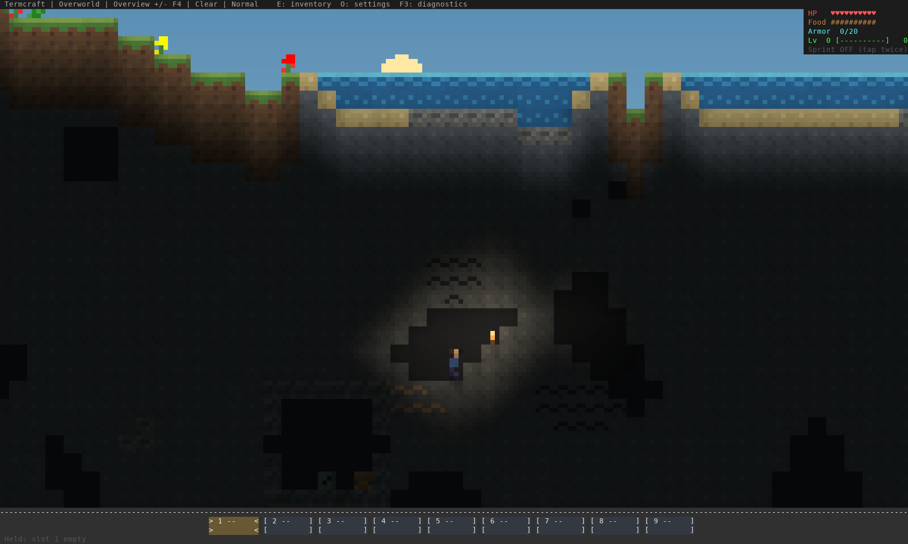
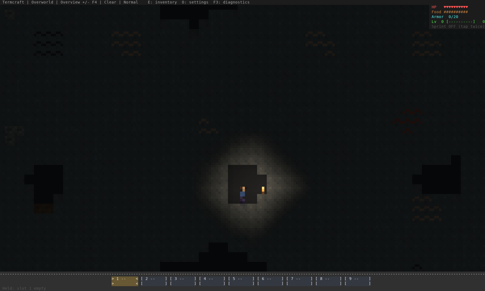

# Deep ore distribution — 16 October 2026

The bottom could become a wall of repeated ore pockets despite the earlier
connected-vein cap. Broad noise fields chose the same ore across many nearby
pockets, and coal/iron continued getting richer downward. Recipe worlds also used
a separate per-block hash, with abundant scattered coal and no redstone.

Implementation: [`52b1c61`](https://github.com/pagel-s/termcraft/commit/52b1c61a4447b01617d5725a1ecdb82420cff33b).
The installed executable SHA256 is
`321835b7c4605f44afda6462f864147a442ed5f20694c786d487b74b3bf029af`.

## Result

One independently selected deposit per seeded, jittered sampling cell replaces
the broad noise fields. Deposit positions, two connected shape families, rotation,
length and ore type vary with the world seed. Clear space between cells prevents
veins from merging across chunk seams. Coal/iron taper toward bedrock; deeper
sections have a more varied mix of smaller redstone, gold and diamond deposits.
Cave exposure can reveal additional parts of those same bounded deposits.

Ordinary and recipe terrain now use the same five-ore rules, with their own cave
geometry. Authored landmark blocks retain their requested contents. No ore art,
tool requirements, drop rules or save/protocol formats changed: network protocol
15, native checkpoint v9, server checkpoint v3 and chunk v2 remain current.

The table measures the **largest count of one ore in any sampled 32-column-wide
bottom section, Y112–126**, across six ordinary-world seed sets. This measures
nearby aggregation even when the constituent veins do not touch.

| Ore | Before | After | Largest connected deposit after |
| --- | ---: | ---: | ---: |
| Coal | 57 | 25 | 12 |
| Iron | 94 | 19 | 8 |
| Redstone | 22 | 14 | 6 |
| Gold | 67 | 13 | 5 |
| Diamond | 27 | 9 | 4 |

The worst sampled bottom section's total ore fraction falls from **22.0% to
7.3%** of host rock in ordinary worlds, and from **15.2% to 9.3%** in recipe worlds.
Coal remains useful earlier in progression: its ordinary-world total increases
16.7% while its bottom-layer total falls 73.3%. Bottom iron falls 81.9%, while
ordinary-world iron overall falls only 5.8%. The change redistributes resources
rather than making every depth uniformly barren. Gold and diamond remain much
rarer overall than iron, and their deposits stay small.

These are measured sample maxima and totals, not universal density guarantees
for every possible seed. Some local variation and empty sections remain intended.

## Verification

The same census code runs against the preceding source `4d36c5d` and the candidate,
with identical seeds, coordinates and recipe settings. Each revision samples
**6,291,456 cells**: six ordinary worlds and six recipe worlds, 4,096 columns per
world, all 128 rows. Recipe cases span Plains, Forest, Desert, Tundra and Mountains;
the ordinary samples cover all ten biomes.

`ores-before.json` and `ores-after.json` retain eight-row counts, host-rock counts,
cave exposure, presence in 64-column regions, connected-vein statistics and
bottom-section statistics. Four-connected vein measurements include chunk seams
and negative coordinates. Densities use stone plus ore as the denominator,
excluding cave air, fluids, soil and bedrock. Sampling boundaries can truncate
veins, so the separate regression crosses additional chunk seams.

New regressions fail on the old generator for bottom aggregation and common-ore
depth progression (`before-clumps.log`, `before-depth.log`). They pass on the new
generator, including recipe terrain. Existing checks for shallow restrictions,
resource availability, visible iron/diamonds in caves and rarity remain passing.
Connected-vein bounds tighten to 12/8/6/5/4 for coal/iron/redstone/gold/diamond.
The existing deep-cave diamond-visibility threshold was retained.

All **750 tests** pass on stable Rust and Rust 1.88. Strict all-target Clippy passes
on both; formatting, the optimized build, six real TCP/MCP integrations and normal
Lantern Run completion/save-reopen pass. Offline crate verification and strict
documentation validation are recorded in `evidence.json`.

The baseline audit was built from an isolated copy of the preceding source. A
shared Cargo output directory temporarily left the baseline example at the
candidate executable path; its output was rejected. The final optimized artifacts
were rebuilt after cleaning that package's release outputs. The retained candidate
census confirms redstone in every recipe world and the new vein limits. The local
game and Lantern Run report match the candidate binary hash above.

The preceding [view/input native matrix](https://github.com/pagel-s/termcraft/actions/runs/38930245714)
is fully successful on Linux, Windows and both Mac architectures. The ore source
passes [general CI](https://github.com/pagel-s/termcraft/actions/runs/38933505783);
its [new native matrix](https://github.com/pagel-s/termcraft/actions/runs/38933505762)
is still running at evidence collection. Pending stages remain unqualified.
Human mining pace, long survival progression and subjective visual acceptance
remain playtest gates.

## Rendered inspection

These are actual terminal-renderer captures of seeded generated caves, with
staged safe player positions and a supported inspection torch. The deep capture's
foothold is Y103; the bottom-layer balance above is established by the census,
not by treating this one screenshot as representative of every bottom section.
Both retained PNGs were decoded and visually inspected. Lighting and art are
unchanged by the ore pass.





## Try and reproduce

Restart the updated local `./termcraft`. Explore newly generated terrain or start
a new world: **existing saved chunks keep their ores and mined areas**. A fresh
world is the clearest comparison. Check fuel/iron while descending, then compare
several bottom sections for repeated same-ore fields and small rare finds.

```sh
cargo test --locked
cargo clippy --all-targets --locked -- -D warnings
cargo test --locked --test multiplayer_tcp -- --ignored
cargo run --release --locked --example generation_audit > /tmp/ores.json
cargo build --release --locked --bin termcraft --example world_review
env -u NO_COLOR target/release/examples/world_review /tmp/ore-atlas
python3 scripts/capture_terminal_art.py /tmp/ore-atlas /tmp/ore-atlas-png
```
