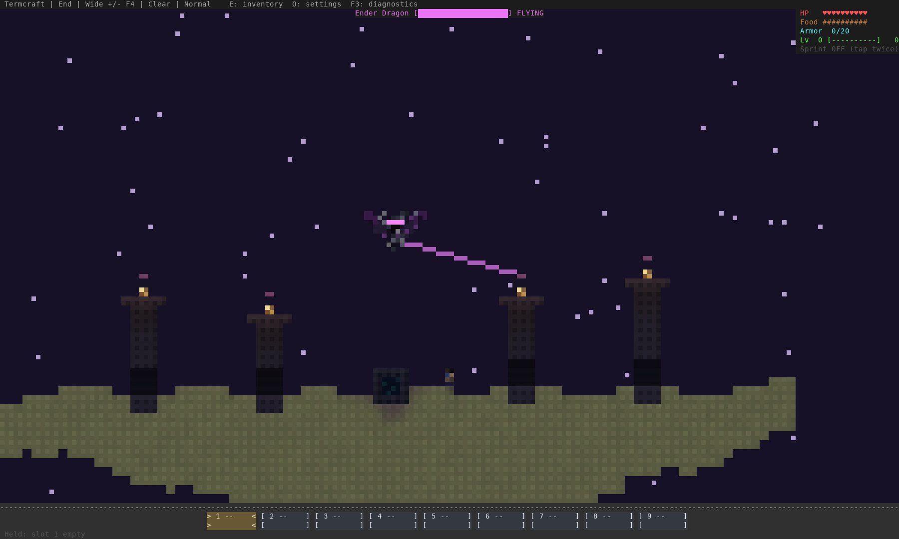
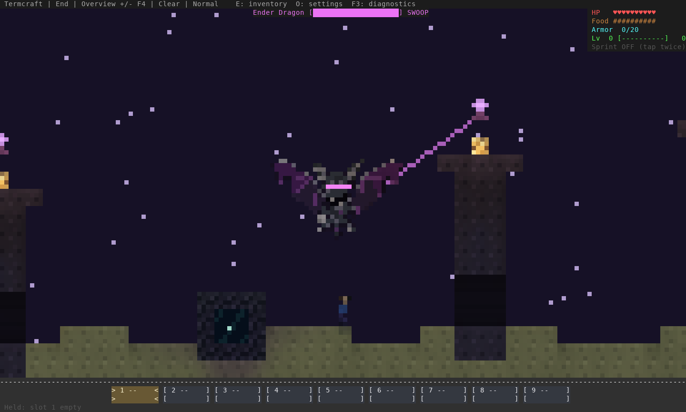
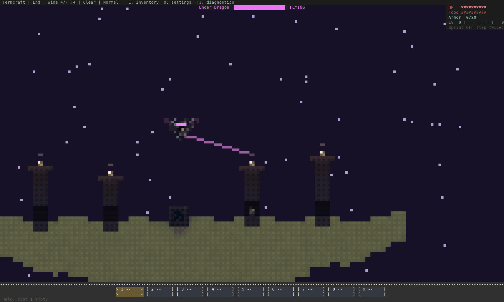

# Taller slim pillars and dragon clearance

Implementation: `9d7d7e6`, with descent/attack-pass hardening in `4a8f43a`, on
`beta/terminal-reborn`.

The four slim pillars are two blocks taller: **11, 9, 10 and 12 blocks** from
ground to crown. Shafts remain three blocks wide, crowns five, with the same
three-block walking passage. The dragon artwork and size are unchanged.

The earlier flight check could oscillate at a crown and keep a swoop aimed at a
player sheltered under a pillar. The reproduced covered-player regression kept
diving for all 160 test ticks. Routing now chooses clearance across the entire
obstacle, holds that altitude until the body passes its far edge, and limits
approach speed while climbing. A dragon under a crown lip first backs into a
clear ascent column. Swept body checks stop at contact without bouncing back
into the obstacle. An unreachable dive is abandoned in favor of patrol; a nearby
open attack position is used where possible.

## Proportions in actual generated terrain

Previous compact pillars:


Raised slim pillars, with the same seed, camera, player anchor and wide view:



Normal overview during an actual simulated swoop:



## Sheltered-player regression

The player is anchored inside the ground passage at x=14.5. The dragon leaves
the blocked approach and keeps patrolling instead of hovering over the crown.
No terrain is carved by this capture fixture.



This is 40 seconds of engine-driven flight, exported at **2.5 fps** to inspect
the path. It does not demonstrate the live game's frame rate or Warp latency.
The camera/player are fixed and the player is kept alive. The normal encounter
still reaches the exposed player: eight contact-damage ticks in 2,400 engine
ticks. [Normal run](normal-simulation.json) · [Sheltered run](covered-simulation.json).

## Existing worlds

Untouched pillars from both preceding layouts are recognized using exact
generated footprints. Compact saved pillars rise two blocks; wide legacy
pillars become the current narrow profile. Checks include the future crown and
headroom, so a build just above an old pillar opts that pillar out too. Modified
or unmatched pillars are preserved. Existing crystals move with their crowns
without changing health or restoring destroyed crystals. A local/live player
standing on a raised crown is moved clear with it; save/reopen is covered by a
regression. No save or wire format changes are required.

Restart the updated executable and enter the End to apply the saved-terrain
check. A process already running the previous executable keeps its old code.

## Verification

- **788 tests pass** on stable Rust and minimum Rust 1.88. Strict all-target
  Clippy passes on both. Seven real TCP/process tests pass.
- Every pillar is crossed from both directions, including starts underneath
  its crown lip, in both the legacy-wide and raised-slim layouts. Every tick
  checks body clearance; crossings and horizontal pauses are bounded.
- Three procedurally generated arenas run for 7,200 ticks each: **18 simulated
  minutes in total**, including exposed, sheltered and moving player targets.
  Body clearance, movement limits, horizontal progress and attack reach pass.
- Descent columns below crown overhangs, completion of offset attack positions
  and unreachable players outside the arena have separate regressions.
- Upgrade checks cover legacy doorways, shorter saved pillars, builds above a
  crown, modified pillars, standing-player/crystal safety and persisted reloads.
- Actual solo terminal travel and solo/co-op walking/jumping in both dimensions
  pass against the installed executable. Co-op starts in an offline fixture;
  client debug-travel commands are deliberately ignored by the host.
- The main [world atlas](../world-atlas-2026-10-15/index.html) has 14 refreshed
  End images, including towers, panoramas and dragon views, with new cache keys.

The review does not establish a complete human boss fight, arbitrary player-built
maze navigation, or native Warp/Windows/macOS presentation quality.

Reproduce with disposable worlds:

```sh
cargo build --release --locked --example encounter_review
env -u NO_COLOR target/release/examples/encounter_review /tmp/raised-end
env -u NO_COLOR target/release/examples/encounter_review /tmp/covered-end --covered
python3 scripts/build_dragon_clearance_review.py --normal /tmp/raised-end --covered /tmp/covered-end --output /tmp/dragon-review
```

The [capture hashes](capture-hashes.json) record raw ANSI and exported image
inputs. [Verification evidence](evidence.json) records the executable/source
hashes, test results, terminal report and relevant limits.
The final installed executable produces [byte-identical ANSI](final-capture-match.json)
for all 205 reviewed capture inputs after the final hardening pass.
