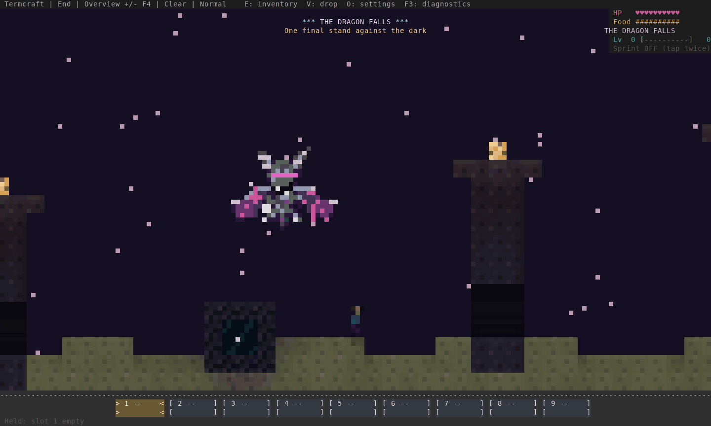
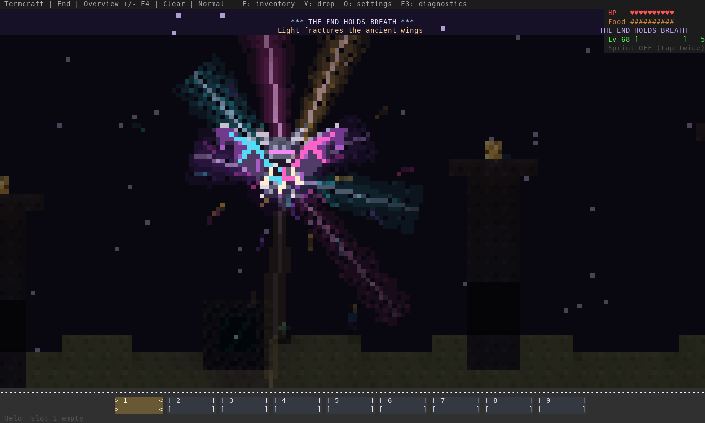
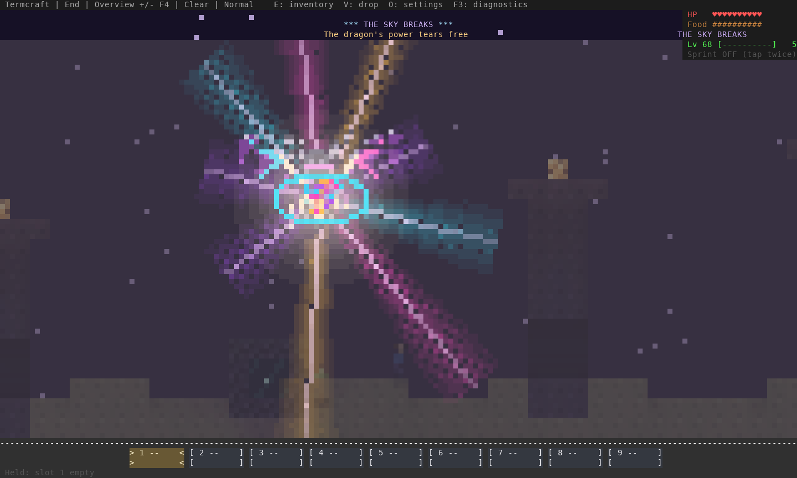
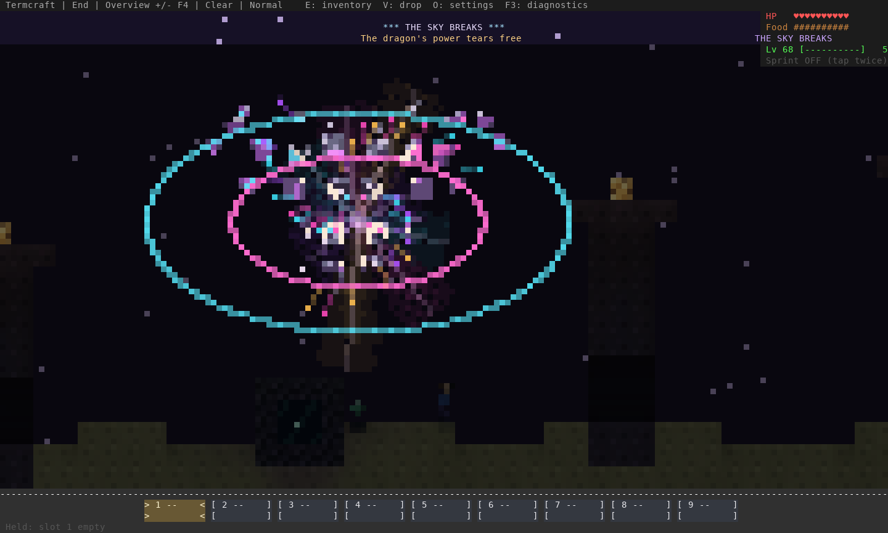
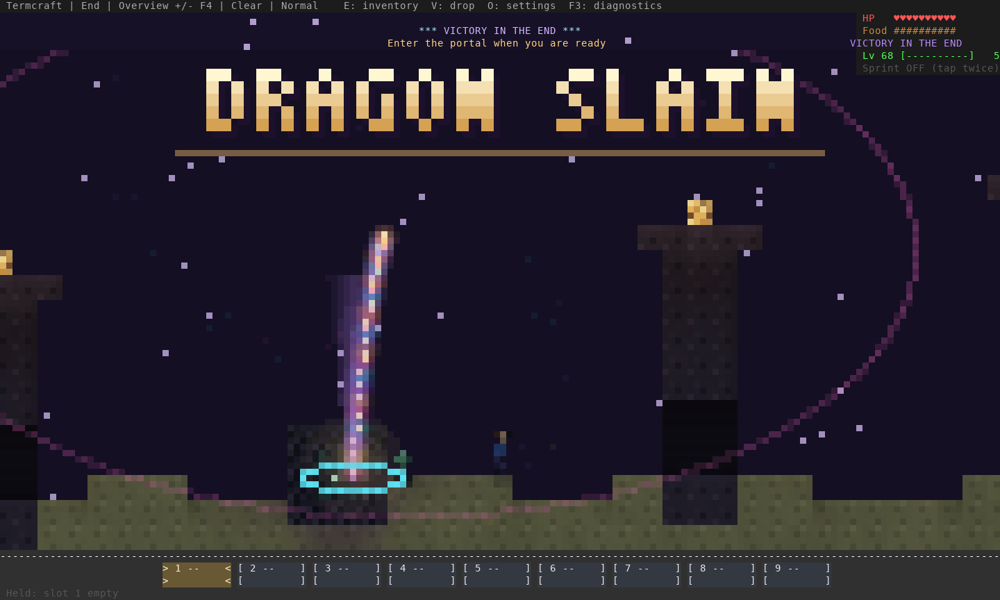
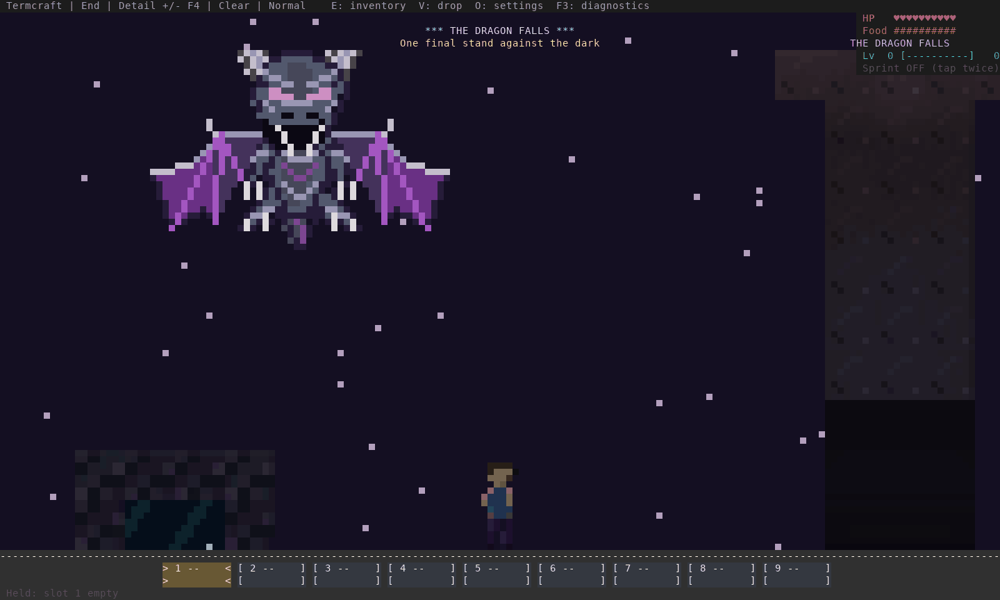
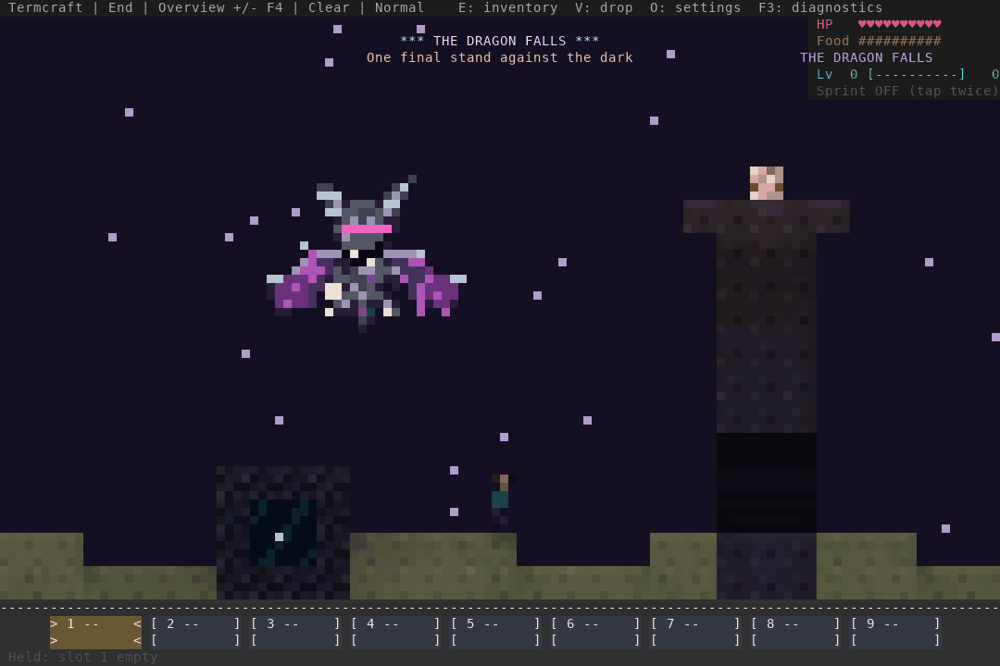
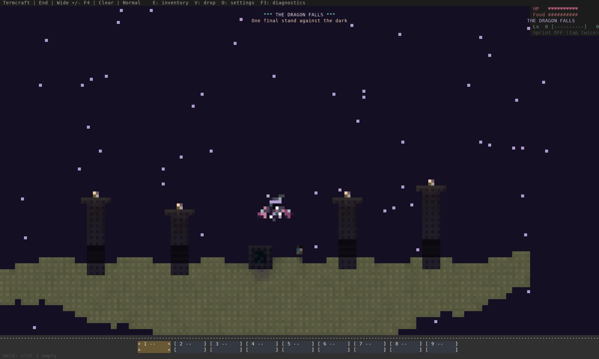
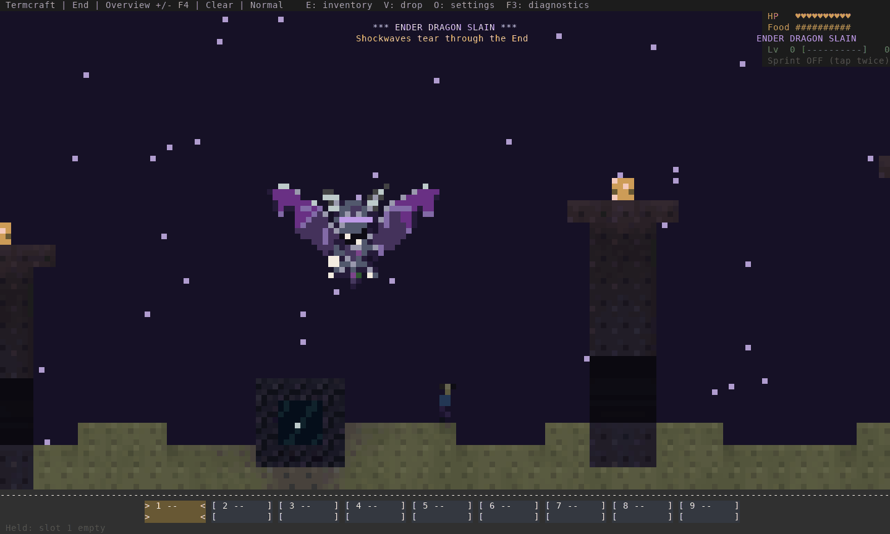

# The dragon’s last stand

A revised **14-second** defeat sequence captured from the real engine and terminal
renderer. The kill, player location and seed are staged in a disposable world.

## Watch the new sequence



[Open the responsive gallery](gallery.html) · [All acts at a glance](sequence.png)

The dragon recoils, opens its maw and spreads its wings into a final stand.
Cyan and hot-pink fractures split the keel and wing ribs as violet, turquoise,
magenta and amber energy gathers inward. The arena dims;
broad shafts split from the chest. A single illumination pulse releases the wing
panels as coherent fragments, with expanding shock fronts and falling sparks.
The last energy bends into the return portal, followed by a large gold victory title.

| Time | Act |
| --- | --- |
| 0–1.8 s | Fatal recoil, opening maw and first fractures |
| 1.8–6.8 s | Ascending wing spread, inward energy, arena lighting and shafts |
| 6.8–10.5 s | Rupture, coherent wing fragments and expanding fronts |
| 10.5–14 s | Portal transfer, gold title and return to ordinary framing |






## Other views

The selected resolution stays fixed. In a close view, a temporary vertical pan
frames the full raised dragon and then returns to the normal gameplay camera.
This can frame the player outside the close-up while the dragon fills the screen;
F4 and +/- remain available. Overview/wide keep more of the arena visible.
Movement and simulation continue throughout the finale.

### Detail · 160 × 48



### Compact · 120 × 40



### Wide · 200 × 60



## Previous version



## Verification and reproduction

The new pose is separate authored terminal pixel art; live flight art is unchanged.
The finale uses the existing replicated/persisted 280-tick encounter clock and
origin. Reward creation, terrain, portal rules, saved view and save/network formats
are unchanged. Existing worlds use the new sequence on their next dragon defeat.

- **822** library tests pass on stable Rust and MSRV 1.88.0; strict Clippy on both.
- Effect tests check deterministic frames, protected header/inventory regions,
  all selected pixel resolutions, clean completion and glyph-mode fallback.
- All four animations decode fully and retain 281 frames / 14,050 ms including
  the final ordinary frame. Shared palettes cover every act; PNG stills retain
  original renderer colors.
- [Capture evidence](capture-evidence.json) identifies the tested binary, source
  hashes, every ANSI input, image hash and staged-render CPU timing.
- [Live terminal verification](verification.json) covers solo/co-op input and limits.

Reproduce with:

```sh
cargo build --release --bin termcraft --example encounter_review
env -u NO_COLOR target/release/examples/encounter_review /tmp/finale-review --victory
python3 scripts/build_dragon_finale_review.py \
  --captures /tmp/finale-review --binary target/release/termcraft \
  --before docs/design/interaction-refinement-2026-10-19/victory.gif \
  --output /tmp/finale-gallery
```

Each incremental ANSI view is decoded into its own continuing screen. Animation
export keeps quantized frames in memory rather than retaining four full RGB movies.
The first candidate’s continuously changing full-arena colors overloaded terminal
output. The final version uses stable lighting/coverage palette levels while
particles and fragments keep moving. Overview ANSI output for the 281-frame
capture fell from 12.79 MB to 3.75 MB. The live check exercises movement, F4,
completion and terminal restoration in both solo and real local co-op.

| Local PTY check | Solo: largest sampled render p95 | Co-op: largest sampled render p95 |
| --- | ---: | ---: |
| Previous finale | 29.37 ms | 31.38 ms |
| First new candidate | 79.62 ms | 82.53 ms |
| Final new candidate | 21.71 ms | 41.45 ms |

These are single local runs, include Python ANSI-decoder backpressure and view
changes, and are not cross-machine FPS results. In particular, the co-op result
does not demonstrate a speed improvement over the previous animation. Offscreen
render CPU measurements exclude terminal/GPU output. Neither measurement
establishes perceived smoothness in Warp, SSH latency or human combat quality.
