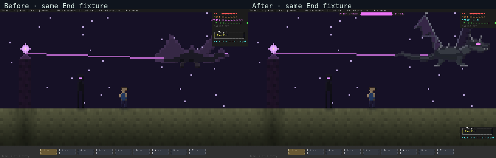
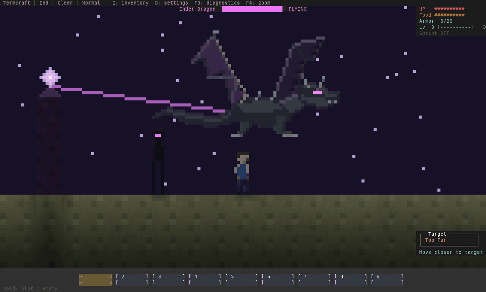

# Ender Dragon refinement — 12 October 2026

The previous audit candidate still had a stretched, low-contrast dragon whose
head could be covered by the target panel. This pass replaces that figure in the
implemented terminal renderer. These are actual ANSI captures from disposable
staging fixtures, not concept art or a completed boss-fight playthrough.



The comparison retains the same geometry, actor positions, clock and 160×48
terminal size. Both columns use the same nearest-neighbor reduction. Full-size
[before](before.png) and [after](after.png) captures are retained.

## Figure and motion

- A 64×40 source canvas replaces the stretched 33×16 figure. The large view uses
  native source pixels; the smaller view preserves the bright eye pixels.
- Separate near/far wings have ribs, joints and scalloped membranes. Seven wing
  poses form a twelve-step cycle; swooping changes its rate. The torso, head and
  feet stay anchored while wings move.
- A tapered curved tail, wedge jaw, pale horns/teeth, dorsal spines and charcoal
  body separate the silhouette from the purple End sky. Both facing directions
  and damage state use the same authored figure and shared scene lighting.
- Crystal beams attach near the existing body/combat anchor. The existing AI,
  health, movement, damage and attack reach are unchanged. Wing/tail extent does
  not create additional collision or attack geometry.
- The Ender Dragon health bar and FLYING/SWOOP cue have their own banner. Armor
  stays visible, and targeting moves above the hotbar during the fight instead
  of covering the dragon’s face in the right-hand airspace.



The loop contains 66 independently complete ANSI frames sampled at 60 Hz from
a fixed-position staging fixture. The GIF uses a 20/10/20 ms duration pattern
(1.1 seconds total), nearest-neighbor reduction to 960×576 and palette quantization.
PNG captures retain the unquantized raster output. This illustrates authored wing
motion; it does not establish boss AI quality, terminal latency or human enjoyment.

## Pose review

| Pose | 120×40 | 160×48 | 200×60 |
| --- | --- | --- | --- |
| raised | [120x40](raised-120x40.png) | [160x48](raised-160x48.png) | [200x60](raised-200x60.png) |
| lowered | [120x40](lowered-120x40.png) | [160x48](lowered-160x48.png) | [200x60](lowered-200x60.png) |
| left | [120x40](left-120x40.png) | [160x48](left-160x48.png) | [200x60](left-200x60.png) |
| swoop | [120x40](swoop-120x40.png) | [160x48](swoop-160x48.png) | [200x60](swoop-200x60.png) |
| hit | [120x40](hit-120x40.png) | [160x48](hit-160x48.png) | [200x60](hit-200x60.png) |


The focused pose fixture centers the dragon at x=0.5, y=32 so its entire wing
cycle fits the viewport. It is separate from the unchanged before/after fixture
at x=6, y=31. Terminal cell ratio should be near 1:2 for square half-cell pixels.

## Reproduce

```sh
env -u NO_COLOR cargo run --release --example dragon_review -- /tmp/termcraft-dragon-audit
python3 scripts/capture_terminal_art.py /tmp/termcraft-dragon-audit /tmp/termcraft-dragon-png
env -u NO_COLOR cargo run --release --example pixel_review -- /tmp/termcraft-world-audit
env -u NO_COLOR cargo run --release --example render_profile
```

The rasterizer uses 9×18 cells and DejaVu Sans Mono for UI glyphs. The examples
create/remove temporary worlds and never open user saves. `src/renderer/dragon.rs`
rasterizes the authored art at compile time; the drawing loop allocates no dragon
frames. Exact source/executable identities, regression results and renderer costs
are in `docs/assets/dragon-refinement-2026-10-12.json`.

Bespoke banking/dive/attack poses, tail articulation, more cinematic boss
composition and human acceptance remain open. This is a visual refinement of
the current encounter, not a redesigned boss battle.
