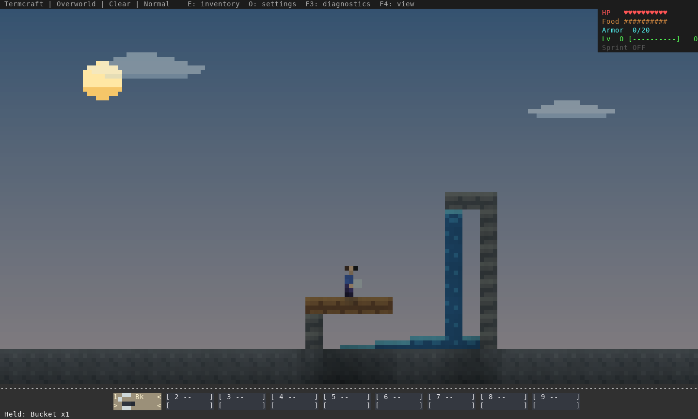
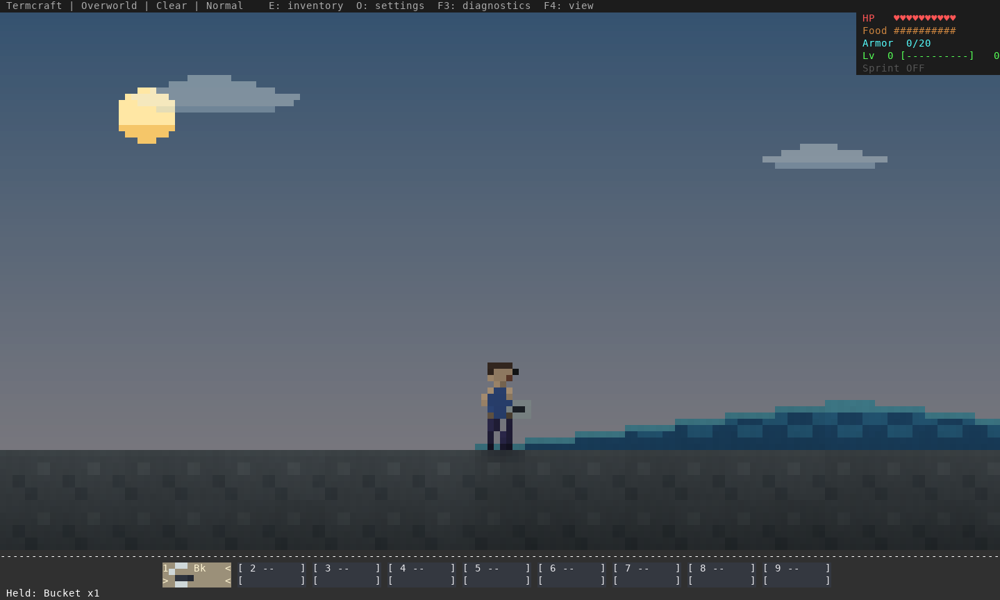
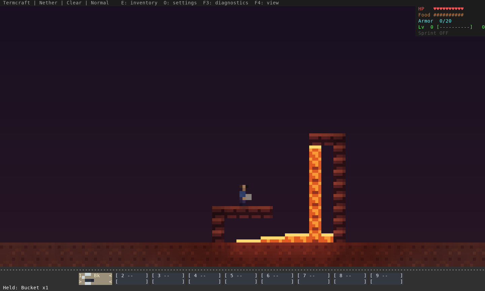
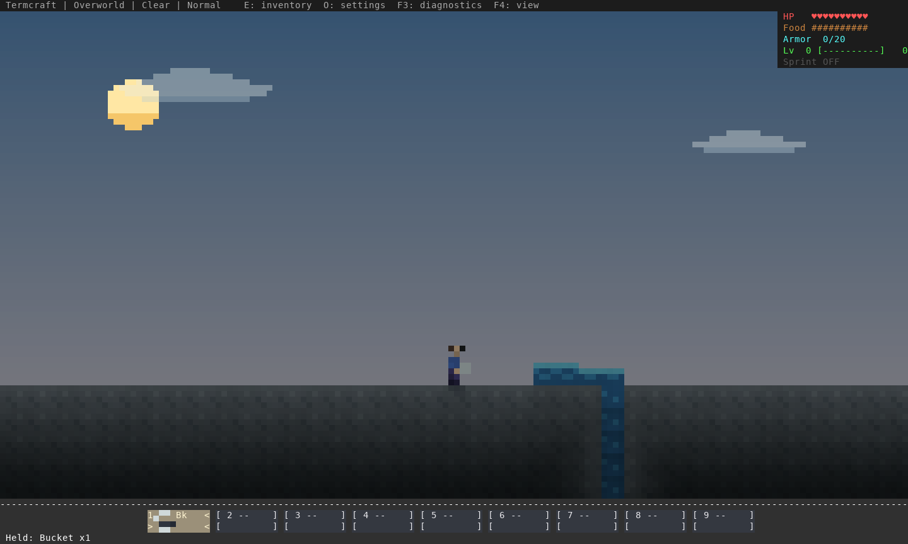

# Fluid flow and depth — 16 October 2026

This records the initial runoff/depth correction. The subsequent
[source-height basin review](../water-basins-2026-10-16/README.md) supersedes its
water-basin and protocol limitations with communicating vessels and overflow.

The previous solver let a filled cell below a waterfall trigger sideways flow at
every row. It also spread across a floor without considering a nearby drop, and
only cooled some lava contacts when water attempted to flow into them. Three
isolated reproductions fail on the previous implementation and pass after this
correction; `evidence.json` records identities and results.

Implementation: [`2eaed94`](https://github.com/pagel-s/termcraft/commit/2eaed9485e8cfac3e780289d2f92e29c0d28e2b1).
The installed executable SHA256 is
`5596e7e959efe5301a61ce8225d90d52f5f3562a527e6683e145c31c6e6610a5`.

## Rules and behavior

- Updates compute from one snapshot, then apply in sorted coordinate order.
  Drainage, overlapping inflows and mixing do not depend on chunk/hash order.
- Falling columns stay vertical until they meet a fluid-blocking tile or source
  pool. Supported horizontal flow prefers the nearest reachable drop; flat ground
  permits both directions. Flow strengths re-evaluate their supply and decay
  after it is removed or blocked.
- Source level 8 remains persistent. Two horizontal water sources regenerate a
  supported gap. Water reaches seven cells; Overworld/End lava three; Nether lava
  seven. Water/Nether lava update every five simulation ticks; other lava every
  thirty. Removing one source does not remove other independent pool sources.
- Water above/beside lava cools the lava itself: source becomes obsidian, flow
  becomes cobblestone. Lava falling into water forms stone. Simultaneous opposing
  inflows into an empty cell form cobblestone deterministically.
- Thin fluid surfaces follow levels. Rendering, immersion, head breathing and boat
  height share that geometry. Falling columns remain full vertically. Shallow
  grounded runoff permits normal land jumps. Fluid-blocking doors permit spill
  around them. Washed-out crops drop their seeds/harvest once.
- Fresh Lantern Run pools use sources; legacy zero-level cells decay safely.
  Save schemas and network protocol remain unchanged. Existing flowing cells
  re-evaluate when their loaded area next simulates; no fresh world is required.

## Visual review

The example stages geometry/player poses in disposable saves, places and collects
buckets through ordinary use commands, and advances actual world ticks. These are
renderer captures, not a survival playthrough or emulator-latency measurement.









The review also captures source pickup/drainage and water/lava mixing at all
three color zooms. A second review caught the old integer terrain horizon leaving
an underground-colored rectangle above shallow fluid; the horizon now uses the
same fractional surface. A pixel regression checks the unfilled area against sky
over real floor geometry at every color scale.

## Reproduce and test in play

```sh
cargo test --locked
cargo clippy --all-targets --locked -- -D warnings
cargo build --release --locked --bin termcraft --example fluid_review
env -u NO_COLOR target/release/examples/fluid_review /tmp/termcraft-fluid-ansi
python3 scripts/capture_terminal_art.py /tmp/termcraft-fluid-ansi /tmp/termcraft-fluid-png
cargo test --locked --test multiplayer_tcp -- --ignored
```

In a playtest copy, pour water against an elevated ledge: it should fall as a
column, then spread on landing. Put a nearby hole in a flat floor and pour beside
it; runoff should favor that hole. Collect the sole source and wait for the
supplied stream to recede. Walk/jump through its shallow edge, then test deep
swimming and climbing onto a bank. Repeat in co-op and with lava in both worlds.
Check all three F4 views and save/reopen before comparing.

The automated suite covers source removal/blocking, bounded reach, actual lava
cadence, source regeneration support, doorway barriers, crop drops, chunk seams
and reversed chunk insertion order at every tick. It also covers puddle immersion,
ground jumping, breathing and boat surface height. The rendered command fixture
checks source placement/pickup, full drainage, nearby-drop routing, lava contact,
and saved flow levels after normal reopening. `checks.json` records those results.

## Collected results

All **732 unit tests** pass on stable Rust and Rust 1.88; both strict all-target
Clippy checks, formatting and offline crate verification pass. All five real
TCP/process tests pass. Native/co-op PTYs confirm run/jump, continued running, releases,
focus loss and terminal restoration on the installed executable. Lantern Run
completes through normal rules and reopens with its progress intact.

The six-scene command fixture checks actual bucket placement/pickup, drainage,
nearby-drop routing, lava contact and saved fluid levels after reopening. Images
were rendered at all three zooms and visually reviewed; four are retained above.
The final native-platform workflows are still running in the retained CI snapshot.
These local results do not qualify unfinished platform jobs or human feel.

## Limits

This retains the existing block/source game model. It does not simulate finite
water volume, pressure, displacement, waterlogged slabs/stairs, physical currents
or fluid-driven boat drift. At the smallest scale a thin flow occupies at least
one pixel. The CPU-only idle timing in the fixture excludes rendering, storage
and WAN latency; it is not an FPS or broad performance claim. Human swimming,
boats and feel still need acceptance. No existing player save was opened by these
checks, and no release was published.
