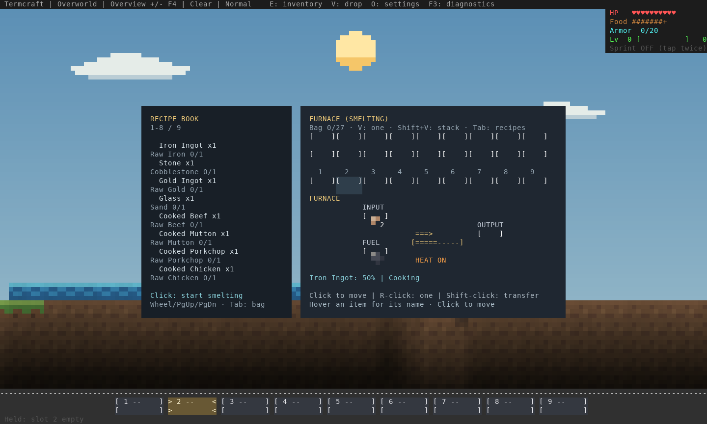
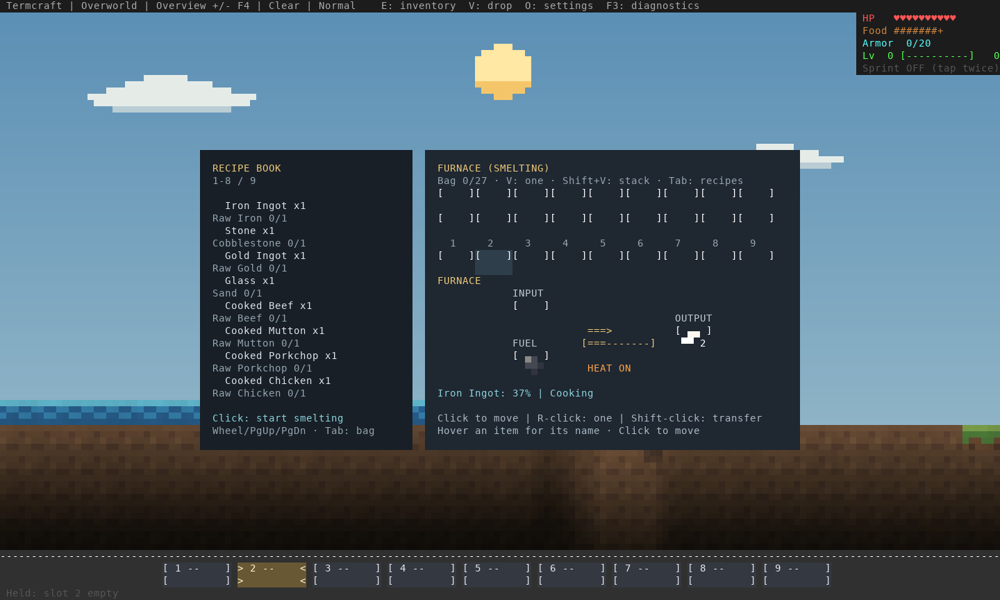
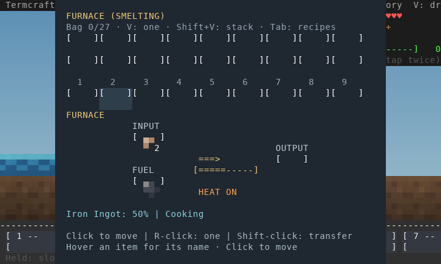
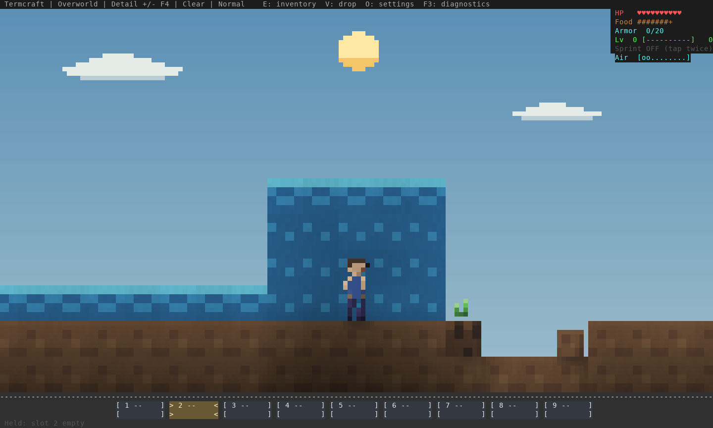
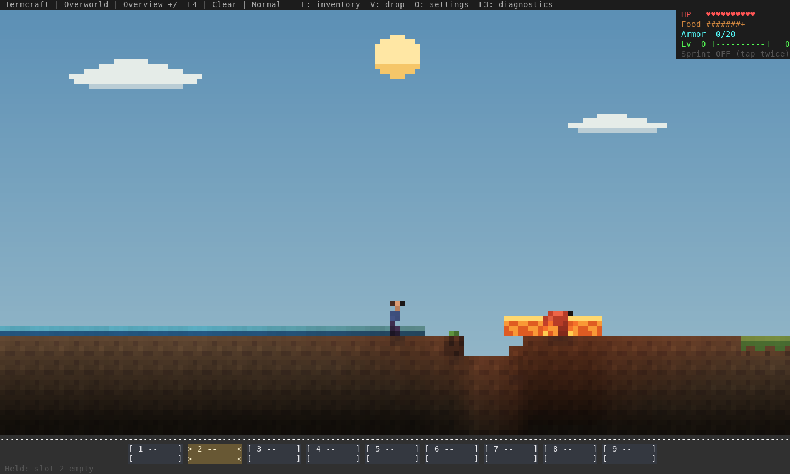
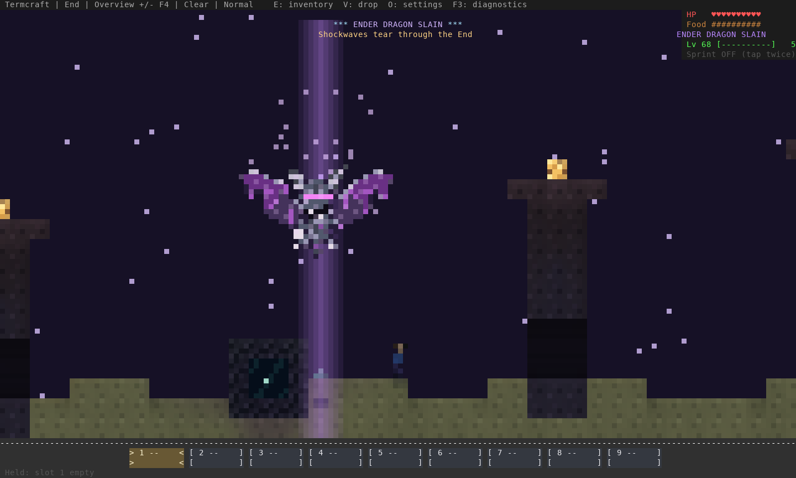
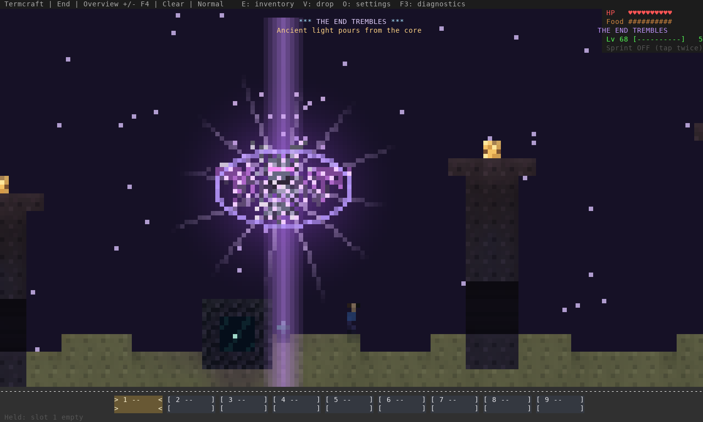
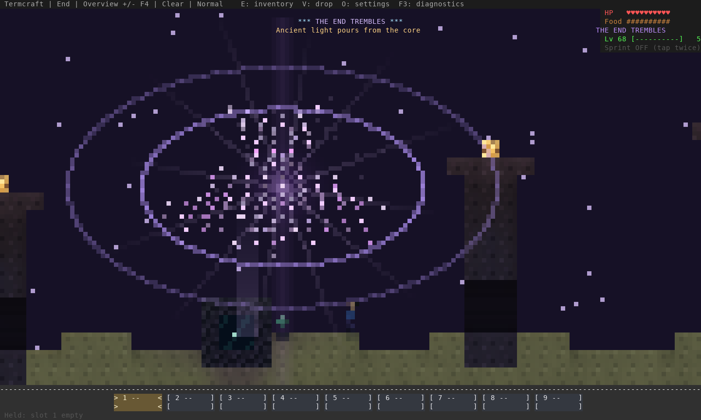
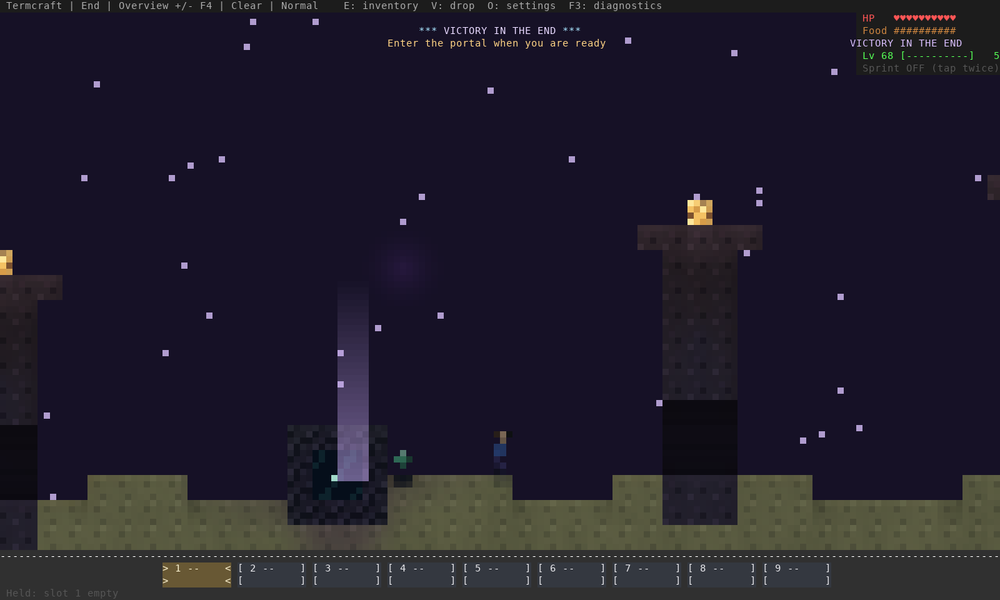

# Interaction and survival refinement — October 19

Review of the actual terminal renderer and engine, following the tool, furnace,
hazards, wall targeting, view preference and autosave reports.

## Furnace

The furnace opens with input, fuel and output slots, a cooking bar and heat state.
Click a bag stack, then its destination; right-click moves one; Shift-click routes
fuel/ingredients or collects output. Coal, logs, planks and sticks burn. Queued
input, fuel, output and active progress survive closing, death and normal restart.
On compact screens the slots remain visible. The existing machine model is still
**one furnace session per player**, rather than independent shared storage in each
placed furnace.

## Held tools

A shorter wind-up leads into a fast strike, follow-through and recovery. An inverse
sprite sampler keeps tools rigid through rotation. The axe head faces outward;
left and right use the same mirrored tool. These loops are cropped/enlarged with
nearest-neighbor pixels from complete real renderer frames (13 engine frames,
50 ms each); they show one normal attack and return to rest.

| Tool | Facing right | Facing left |
| --- | --- | --- |
| Sword |  |  |
| Axe |  |  |
| Pickaxe |  |  |

## Air, lava and targeting

The air meter shows remaining breath. Fifteen seconds underwater exhausts air;
drowning then deals two damage each second and bypasses armor. Air replenishes
gradually. Creatures have persistent breath and fire timers; squid breathe water,
undead need no air, and blazes/ghasts/zombie pigmen resist lava/fire. Water quenches
burning; rain cannot cancel lava contact damage.

The warning capture primes the breath timer, then runs a normal underwater tick.
The cow below takes actual lava damage and shows the same burning feedback.

Hostile acquisition now checks terrain visibility. Skeletons cancel their bow
wind-up when sight is lost; co-op mobs choose a visible player rather than a
closer player behind a wall. Exact grid-corner crossings test both adjacent cells.
Reachable exposed faces and empty slab/stair halves still work. Portal tests now
approach reachable frame faces instead of clicking enclosed corners.

## Dragon finale

The shared sequence lasts **14 seconds / 280 ticks**: an intact charge, energy
column and inward motes, fracture and expanding shock fronts, then a lingering
return-portal reveal. Rewards and the portal still appear once on the actual
boss-death path. There is no camera shake. This disposable encounter stages the
kill; it is not a recording of human combat.

## Saves, tests and limits

F4 and +/- selection lives in save-root `view.json`; ordinary restart restores it.
All creature families and loose item/XP physics suspend without their terrain.
This prevents distant loot from falling into coordinates rejected by autosave.
Finite old loose-item falls outside the End recover above real terrain at the same
X, preserving their payload. Normal creature despawn rules still apply.

The exact setting-related warning reported by the player is still unknown. Every
settings command has been exercised with save/reopen in an isolated world, and the
unloaded-loot failure has a regression test; this does not establish the cause of
a specific player's warning without its text.

Native save **11**, server **5**, protocol **18**. Genuine earlier-build native
v9/v10 and server v3/v4 fixtures verify migration, rather than relabeling a current
save. Older binaries cannot read the new format.

- **811** tests pass on Rust 1.98.1 and MSRV 1.88.0; strict Clippy on both.
- All **7** real loopback multiplayer tests pass, including restart, portals and
  simultaneous dimensions.
- Real native/co-op terminal input verifies the furnace's three slots, cooking,
  output collection, conserved supplies, compact resize and view persistence.
- Existing real inventory/crafting and moving-view checks pass in both modes.
- Full CLI Lantern Run completes and reloads after breaking cover through normal
  mining/jumping controls in five consecutive runs; its script no longer attempts
  attacks through cover.
- Six player-checkpoint fault cases and 24 multi-dimension rollback/interruption
  cases pass, conserving all inventory/chest/loot supplies.
- The packaged Linux archive runs with an empty PATH, saves/reopens via MCP and
  restores its terminal. The source crate also packages and compiles offline on
  MSRV. Windows/macOS qualification runs in GitHub Actions.

Local PTYs and deterministic rendering cannot establish Warp/GPU presentation,
WAN latency or human judgment of combat feel. The unchanged player-motion system
is covered by existing movement checks; this pass changes strike presentation,
not the acceleration tuning.

[Core implementation cad4472](https://github.com/pagel-s/termcraft/commit/cad447208b7e75bd407b1b35bacd61bab3ac836b).
[Capture hashes](capture-evidence.json) include every ANSI input and exported image.
[Verification record](verification.json) identifies the exact binary and checks.

To reproduce, build release examples with the same checkout, unset `NO_COLOR`, run
`interaction_review`, `encounter_review --victory`, and `encounter_review` into
three temporary directories, then run `scripts/build_feedback_review.py` with
those directories, the output directory and the tested binary. Reuse one ANSI
screen when reading incremental animation frames.
