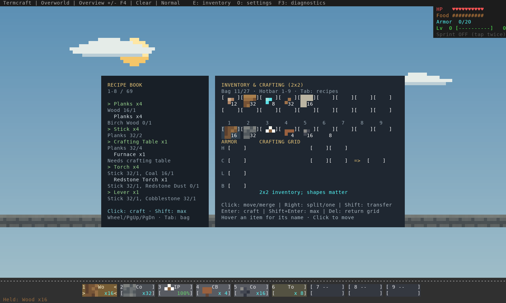
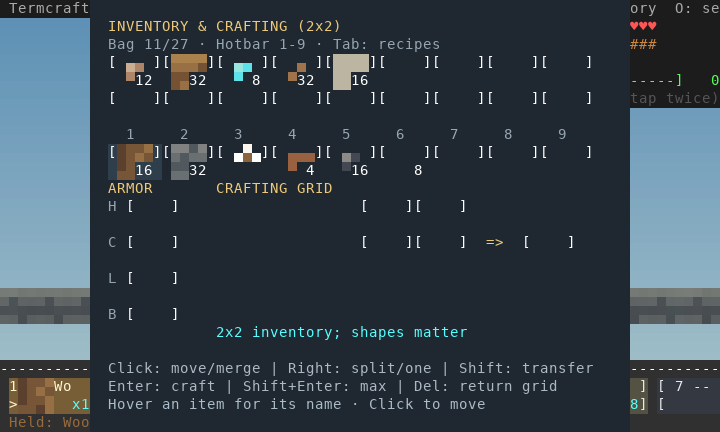
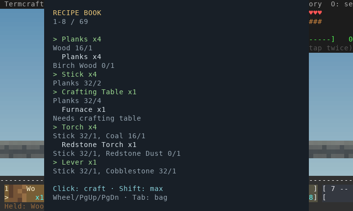
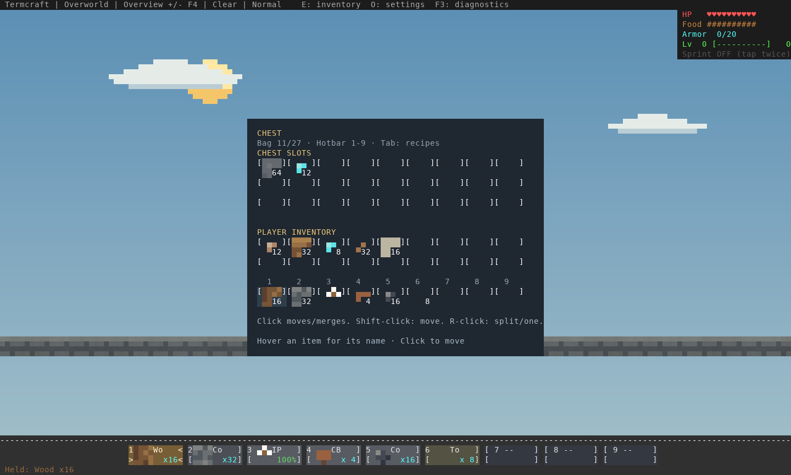
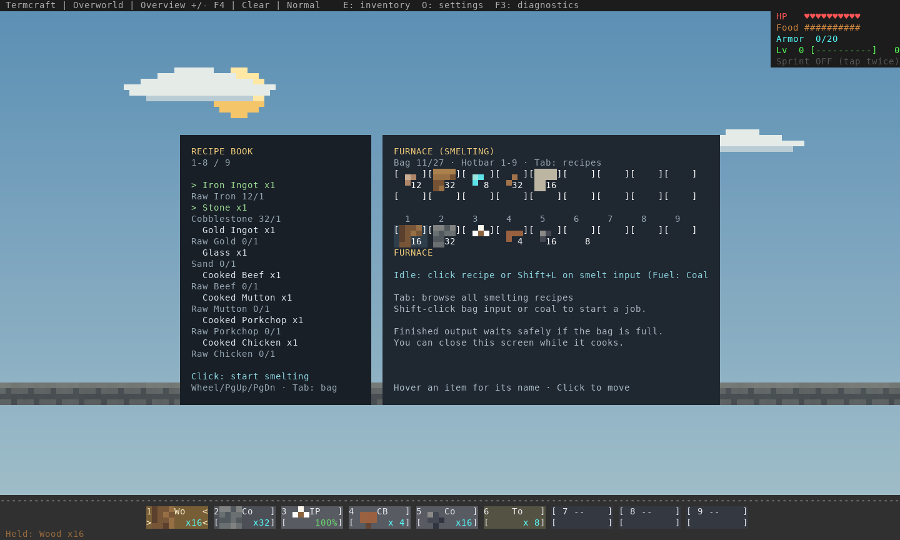
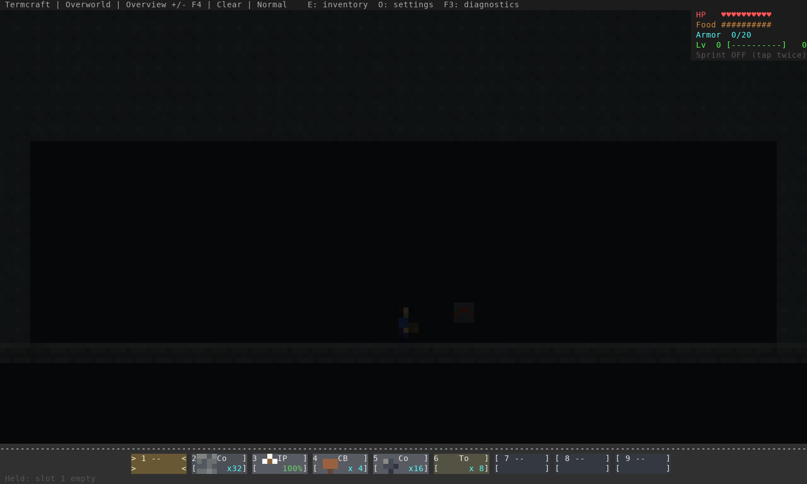
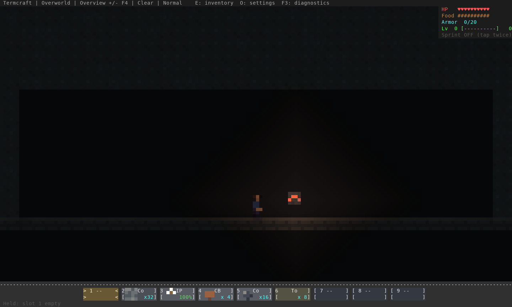
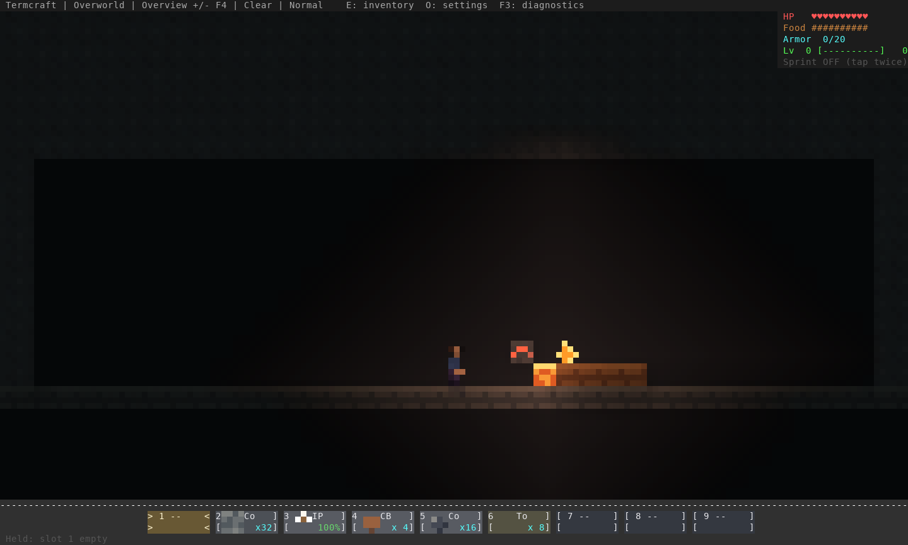

# Inventory and survival interaction review — 16 October 2026

This pass addresses eating feedback, redstone-ore activation, lava/fire and the
inventory/crafting flow. The user confirmed that the detailed view works in Warp;
the character atlas and zoom resolution are unchanged.

## What changed

- Fractional hunger such as 19.9975 formerly displayed nine full food icons and
  a half, immediately after a meal. Food and health icons now round consistently
  to half-icon units. Food is refused while the displayed bar is full, preventing
  another meal being spent on a tiny fractional drain. Nutrition values remain
  the same.
- A full bag previously attracted items toward the player, repeatedly failed
  collection and reinserted them. Those drops now settle under gravity. Collection
  resumes when capacity opens; a nearby friend with capacity can collect them.
  Lava and fire destroy loose items.
- Main storage sits above the numbered hotbar. Hovered names and the moving
  remainder are readable; ordinary clicks merge compatible stacks. Picking uses
  the same exact slot rectangles as painting, including empty padding.
- The recipe book supports one-click and Shift-click batch crafting from bag
  supplies, wheel/Page Up/Page Down scrolling, and Tab switching at compact sizes.
  Manual grids use whole-stack left placement and one-item right placement/drag.
  Co-op now carries the same drag operation to the authoritative server.
- Recipes check room for the complete output after consuming their inputs in a
  temporary inventory. A blocked result consumes nothing; batch crafting stops.
  Delete returns the grid only when it fits. Closing returns items and leaves
  overflow on the ground. A completed furnace waits for space without spending
  additional fuel, including across a restart.
- Hitting, using or stepping on redstone ore activates a roughly five-second
  light. Rendering and simulation use emission 10; mining hardness, tool level,
  redstone drops and XP match unlit ore. Ore activation supplies no circuit power.
- Lava ignites exposed fuel; direct contact consumes fully submerged wood too.
  Fire burns local fuel, primes TNT, respects water and fire resistance, and
  expires when fuel is spent. Flint/steel supports fire placement while retaining
  valid portal ignition priority. Stone/chests are not fuel; netherrack can retain
  fire. Cached activity/fuel counts avoid ignition scans of bare lava oceans.

The implementation is in `src/renderer/inventory.rs`, `terminal.rs`,
`src/engine/state.rs`, `actors.rs`, `network_client.rs`, `src/world/item.rs`,
`heat.rs`, `block.rs` and the shared lighting/material code. Fire and lit ore are
appended block variants; existing worlds remain readable. Use matching
**protocol 16** clients/server. Older development builds may reject saved chunks
containing the new variants. Native/server/chunk/journal payload versions remain
9/3/2/1.

## Review captures

These use the actual renderer with staged supplies/geometry. They are software
terminal captures, not images generated to suggest unimplemented behavior.

### Bag and recipe book



### Compact bag and recipe book





### Chest and furnace





### Ore activation and lava ignition







## Validation

Final source: `e218e48`; feature `095bd35`, co-op dragging `308cc9b`. General
GitHub CI succeeds on the final source. Windows, Linux and ARM Mac native jobs
also succeed; Intel Mac is still running at evidence collection.

[Native input capture](native-inventory-input.png) · [Co-op input capture](coop-inventory-input.png)

774 library tests pass on stable Rust and minimum Rust 1.88. Strict all-target
Clippy, the seven real TCP/process regressions, normal Lantern Run, storage-fault
matrix and terminal checks are recorded in `evidence.json`. Additional renderer
checks cover the final furnace panel cleanup.

`scripts/test_inventory_input.py` stages supplies offline, then uses actual mouse,
drag, keyboard, scroll and resize input in solo and co-op. It checks saved totals
only after the owners exit: 80 cobblestone, 78 planks, 8 sticks, 4 coal and 3 meals
remain after the prescribed merges/crafts/eating. The bow/missed-swing/eating PTY
route also passes; its fixtures now start hungry instead of relying on wasting
food while nearly full. The Linux native workflow runs the inventory route.

Library tests cover full-bag drops and resumed collection, a full player not
blocking a friend, all food types, full-output capacity and freed input slots,
manual grid operations, blocked furnace save/reload, ore reach/occlusion/light
expiry/drop rules, fire/water/lava contact, and saved/networked heat timers.

Reproduce with:

```sh
cargo test --locked
cargo build --release --locked --example interaction_review --example inventory_review
python3 scripts/test_inventory_input.py --binary target/release/termcraft \
  --fixture target/release/examples/interaction_review --report /tmp/inventory.json
env -u NO_COLOR target/release/examples/inventory_review /tmp/inventory-captures
python3 scripts/capture_terminal_art.py /tmp/inventory-captures /tmp/inventory-captures
```

The terminal checks use disposable Unix PTYs and do not measure Warp/GPU latency
or establish human UX/art acceptance. Fire is a bounded loaded-region game rule,
not a physical heat/combustion simulation. These are development changes, not a
published release. See the [controls and rules](../../gameplay.md#inventory-and-crafting).
