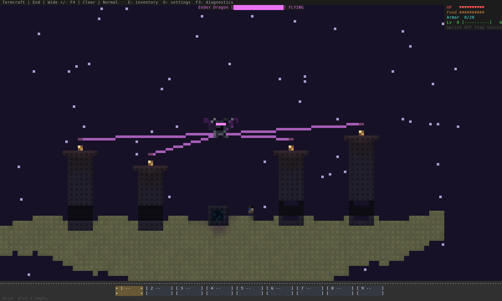
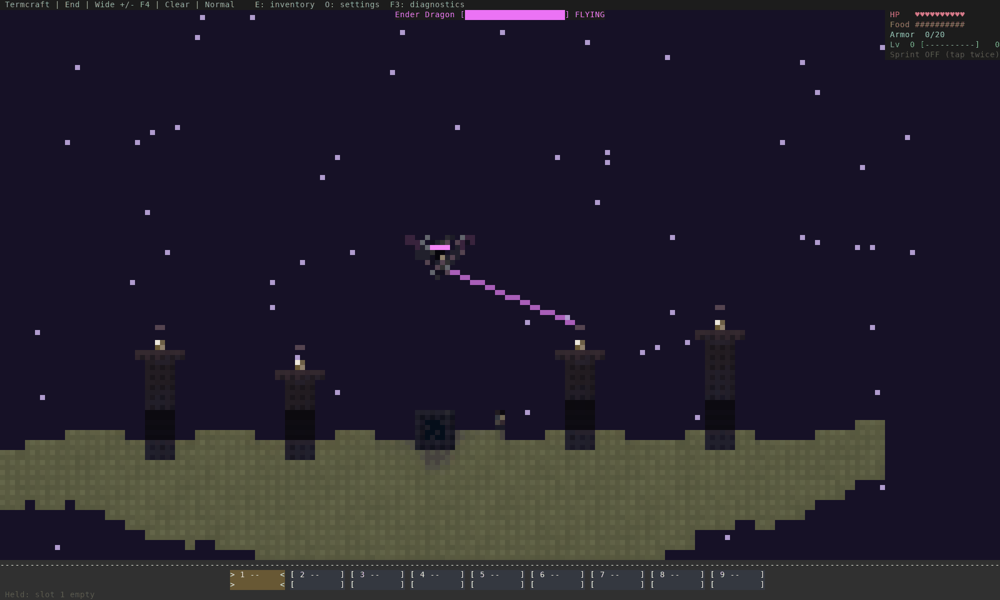
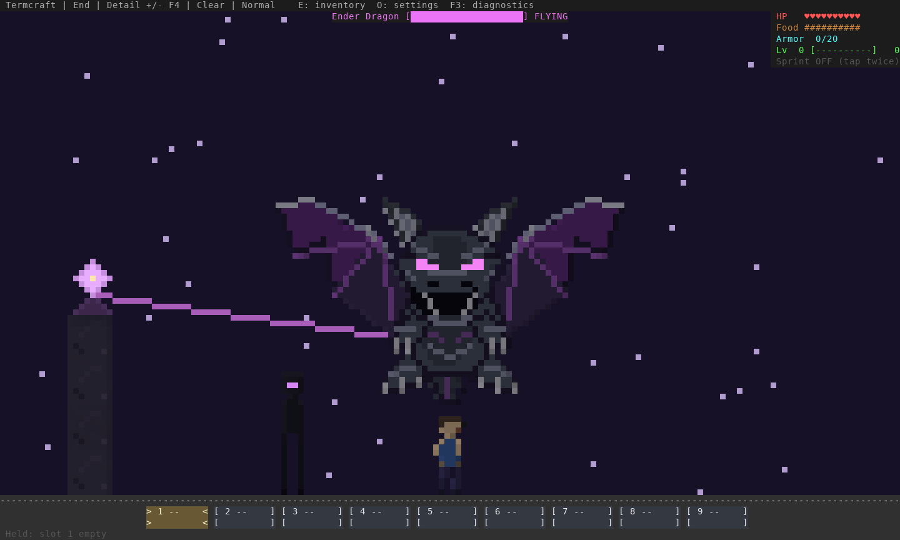
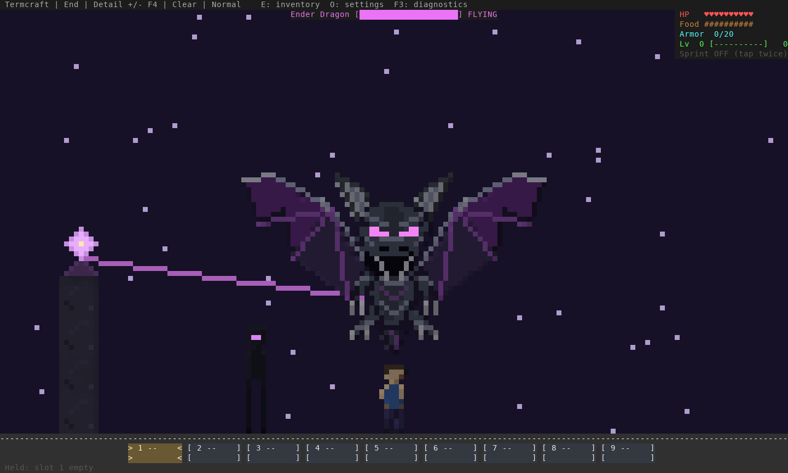
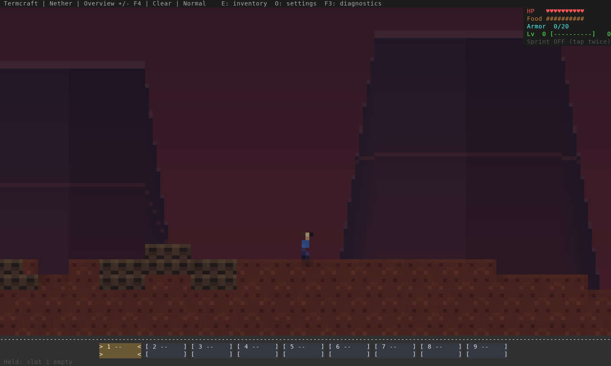
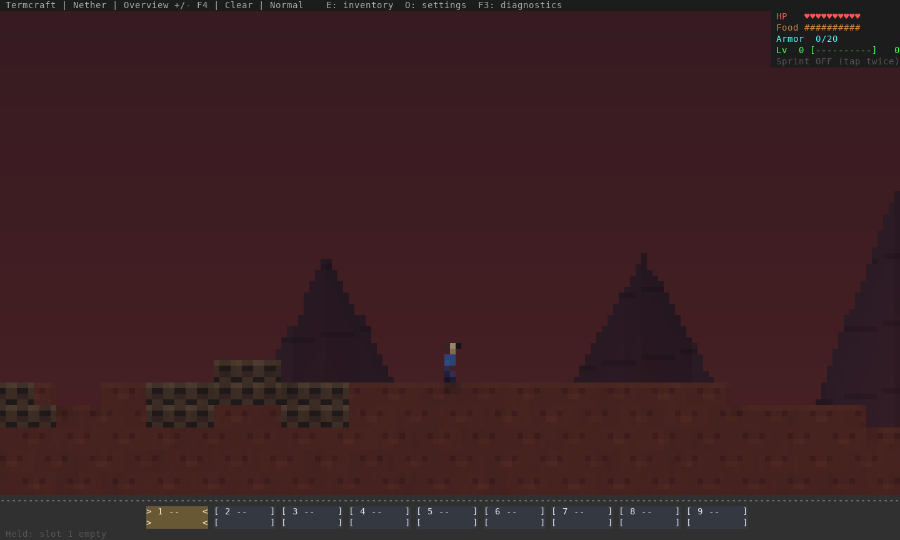
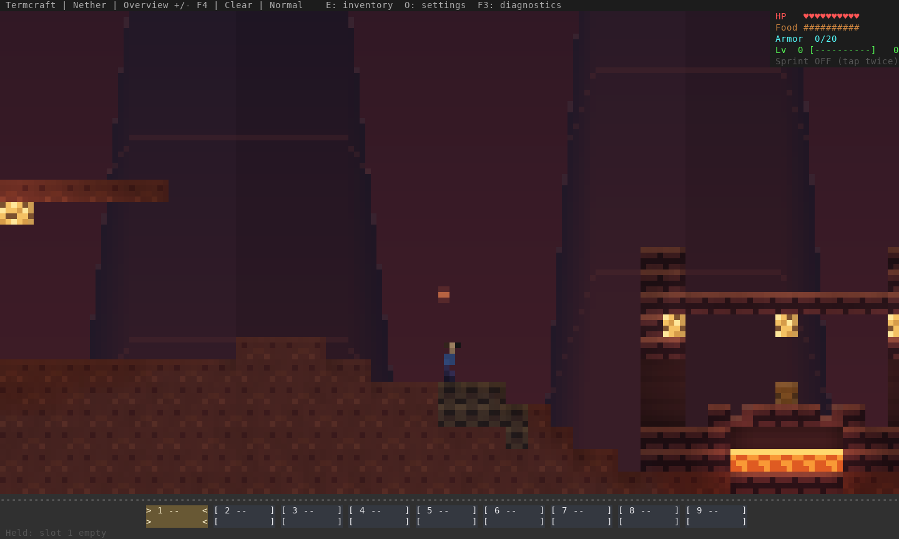
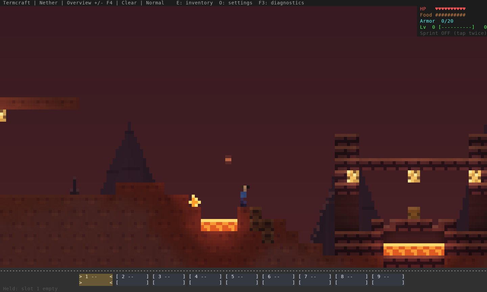

# Nether and End encounter refinement

[Open the comparison page](comparison.html). Main implementation: `05797f8` on
`beta/terminal-reborn`, with tether/input follow-up `02ac78b`. These images come
from the game renderer. [Exact source, executable and check evidence](evidence.json).

The old dragon chased a patrol waypoint that circled much faster than it could
fly, and its two point collision checks repeatedly bounced it into pillars.
Patrol waypoints now move at a reachable speed. Flight looks ahead, climbs over
obstacles, checks the complete head/body envelope and recovers upward if a saved
dragon starts inside a pillar. Swoops have enough time to reach the player and
continue into the contact hitboxes before returning to patrol.

The frontal dragon keeps its horns, glowing eyes and broad animated wings, with
a narrower skull, tapered chest, longer forearms and tucked legs. Combat ellipses
follow the smaller body. Wings project in front of obsidian pillar faces during
close passes; the body still respects terrain. Other creatures retain normal
terrain occlusion. The player artwork and view controls are unchanged.
The healing effect shows one tether to the nearest surviving crystal rather
than four large beams crossing the entire encounter. Regeneration is unchanged.

Generated pillars now have three-block shafts, five-block crowns and heights of
7–10 blocks, reduced from five/seven blocks wide and 11–16 blocks tall. The
three-block ground passages remain. Existing pillars upgrade only when their
entire checked footprint matches the previous generated shape, including the old
initializer's doorway variant. Mining or building inside that footprint opts the
whole pillar out. Nearby builds, destroyed crystals and edited pillars are
preserved; surviving crystals move with an upgraded crown. Checkpointed chunk
saving handles the geometry edits. Unknown older pillar shapes are retained.

The Nether backdrop replaces large flat-topped mesas with smaller recessed,
faceted crags, quieter sloping strata and warmer depth haze. These features stay
fixed in world coordinates; there is no extra parallax movement. Netherrack has
sparser overview grain and its own detailed crack texture. Newly generated
caverns include small, enclosed lava fissures and persistent netherrack fires at
walking height. Fortress approaches are excluded; landmark generation follows
and retains its authored routes. Existing Nether terrain is preserved, so the
new fissures require unexplored chunks. Backdrop/material changes apply in old
saves immediately.

## Actual generated arena

Before:



Now:


The same seeded arena, player position and wide view are used above. This is
generated terrain, not the low pillar staged in the dragon portrait fixture.



This animation decodes sequential incremental ANSI output from 800 engine ticks
(40 seconds), exporting every eighth tick at 2.5 fps. The fixed player is kept
alive and anchored for repeatable attacks. It reviews the flight path, rather
than demonstrating live frame rate or a human boss fight. The full 2,400-tick
run covers about 46 horizontal blocks and records eight contact-damage ticks.
[Trajectory](trajectory.json) · [Simulation timings and limits](simulation.json).

## Frontal proportions

The pose and small crystal pedestal below are explicitly staged to compare art.
They do not establish real arena scale.





## Generated Nether

Same cavern and camera, before and now:





The route near x=96, before and now. The current player is placed on the nearest
safe bank because the former exact standing column is now part of the fissure.
No scenic terrain is carved by the capture example. Exact current positions are
in [the position record](nether-positions.json).





The comparison page also includes fortress views, a staged creature encounter
above generated ground and a smaller-terminal End view.

## Validation and limits

- 780 tests pass on stable Rust and minimum Rust 1.88. All-target strict Clippy
  passes on both. Seven opt-in TCP/MCP integration tests pass.
- Legacy-height flight tests cover players on both sides and at the island edge,
  require contact reach, bound stalled intervals and check body clearance every
  tick. An embedded saved dragon escapes without altering terrain.
- Pillar upgrade tests cover both old generated variants, modified pillars,
  nearby player storage, idempotence and persisted reloads.
- A fissure crossing a chunk seam keeps one source level. Repeated fluid and
  heat updates leave it sealed. Existing Nether traversal, fortress, landmark,
  lighting, fluid and save-recovery regressions pass.
- The presentation regression checks that frontal wings cover obsidian pillars
  while respecting other terrain. Existing eye/zoom, combat and actor occlusion
  checks remain in place.
- Actual solo terminal input visits both dimensions with F6/F7, then walks and
  jumps. Co-op starts from offline dimension fixtures because client debug travel
  is deliberately ignored by the host. Both generated dimensions pass movement,
  rendering, clean exit and terminal restoration. MCP only observes the player.

[Final terminal report](terminal-input.json) ·
[Solo Nether](native-nether.png) · [Solo End](native-end.png) ·
[Co-op Nether](coop-nether-nether.png) · [Co-op End](coop-end-end.png).

The [counting-writer render profile](render-profile.json) reports p95 around
1.31 ms for Nether and 0.91 ms for the dragon at 200×60. It excludes simulation,
input, networking, operating-system output and terminal-emulator/GPU work.

These checks do not establish subjective art acceptance, a complete survival
boss fight, arbitrary player-built arena navigation, Warp GPU performance or a
native Windows/macOS play session. No save or wire format changes are required.

Reproduce from disposable worlds:

```sh
cargo build --release --locked --example encounter_review --example dragon_review --example nether_review
env -u NO_COLOR target/release/examples/encounter_review /tmp/encounter-review
env -u NO_COLOR target/release/examples/dragon_review /tmp/dragon-review --front --detail
env -u NO_COLOR target/release/examples/nether_review /tmp/nether-review --creatures
```

`scripts/build_encounter_review.py --help` lists the before/after input directories.
The builder verifies all exported PNG/GIF files and records [capture hashes](capture-hashes.json).
