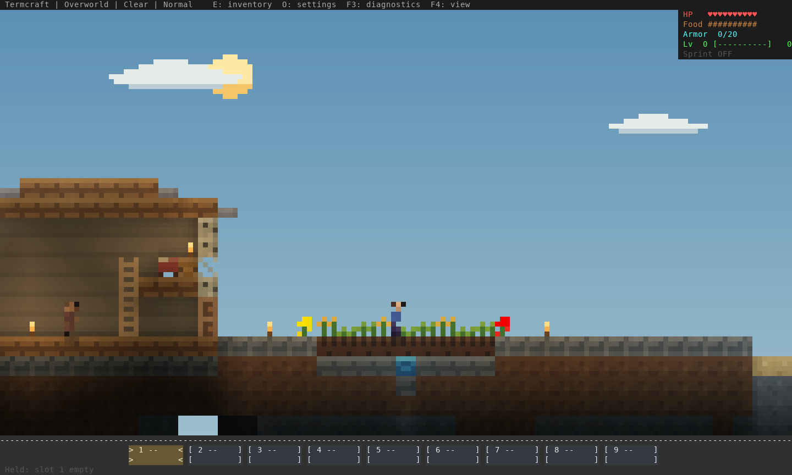
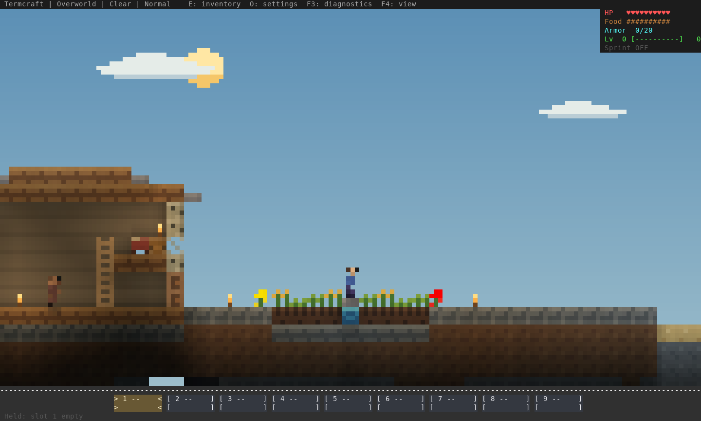

# Ore availability and visible irrigation — 16 October 2026

More frequent small deposits answer the scarcity feedback without restoring huge
coal seams. Depth limits and the coal/iron/rare-ore progression stay in place.
The same three disposable seed sets cover 12,288 columns / 1,572,864 cells.

| Ore | Previous total | New total | Change | Largest connected vein, before → after |
| --- | ---: | ---: | ---: | ---: |
| Coal | 16,902 | 16,831 | -0.4% | 28 → 12 |
| Iron | 9,836 | 11,875 | +20.7% | 16 → 17 |
| Redstone | 591 | 831 | +40.6% | 12 → 12 |
| Gold | 596 | 792 | +32.9% | 12 → 12 |
| Diamond | 215 | 311 | +44.7% | 10 → 11 |

The rounded coal pockets now contain at most 12 connected blocks, including at
chunk seams. Coal is spread across more small deposits; its total stays nearly
constant. Before/after counts, cave exposure and connected-vein distributions are
in [ores-before.json](ores-before.json) and [ores-after.json](ores-after.json).

Village gardens previously used an intentional shallow irrigation source under
the planted soil. That custom 2D rule worked, but concealed the water. New gardens
have a visible one-block-deep channel at soil level, between four planted blocks
on either side. A stone slab crossing rises half a block and keeps the walking
route continuous. The eight plots remain hydrated through repeated fluid/farming
updates and save/reopen checks. Existing buried irrigation remains functional.

[Detailed view](garden-detail.png)

Buckets now place against the aimed face of a solid block, or into the exact open
cell clicked. If that face is occupied, the bucket stays full; it does not search
other faces and pour into an unseen pocket beneath the field. Both water and lava
buckets have a regression for that case. To irrigate a player-built field, dig a
one-block-deep trench beside the soil, pour into the open trench, and plant up to
four soil blocks away. Seeds go on top of the farmland that was clicked.

Verification: **698 tests** on stable Rust and MSRV 1.88, strict all-target Clippy
on both, formatting, and all four real TCP/process integrations passed. The actual
native PTY walk traversed 90.7 blocks and all six doors, with no jump inputs; the
only raised surface was the expected half-block irrigation crossing. See
[native-village.json](native-village.json). This checks controls and collision;
human enjoyment and emulator latency are separate.

These generation changes affect fresh chunks and newly generated villages.
Existing mined areas, deposited blocks and saved settlements are preserved.
