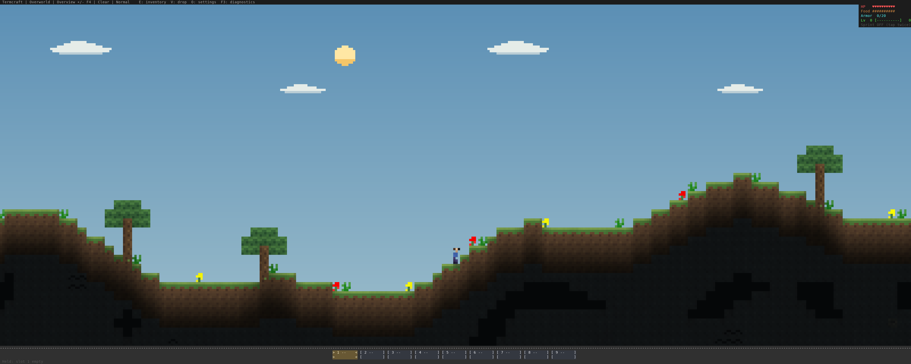
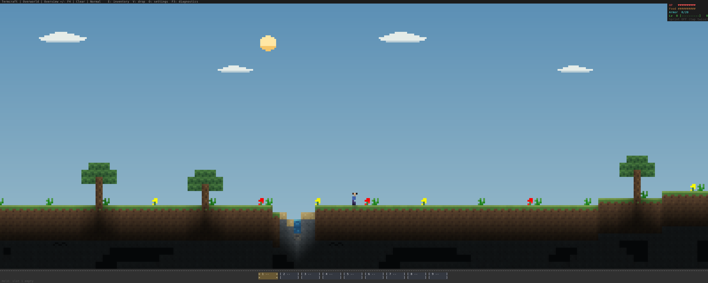
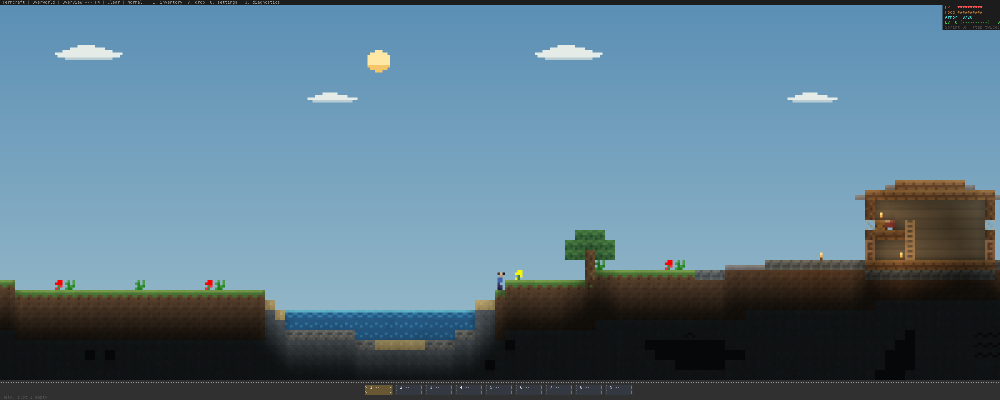
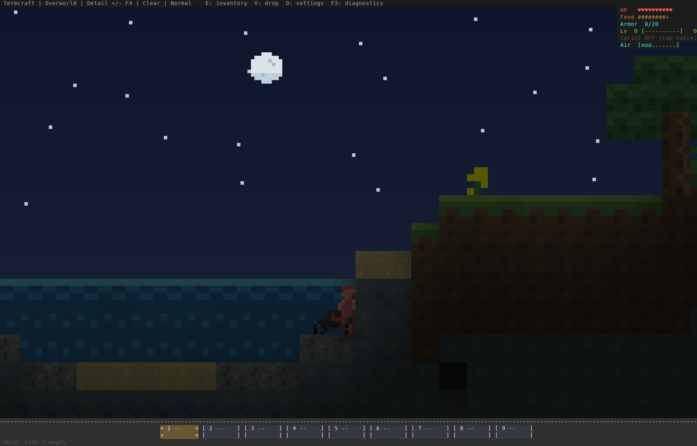

# Overworld travel and nighttime spawning — 23 October 2026

This review follows reports of fragmented land, abrupt slopes and empty surface
nights. It uses disposable generated worlds and the native renderer, with no
terrain repainting or generated artwork. Older atlas images remain dated records
of their original captures.

## Terrain

River noise now follows the scale of the landscape rather than repeatedly
cutting short hills into islands. Land relief changes more slowly; mountain
height blends through the surrounding climate instead of jumping at a biome
label. A bounded bank grade reaches the water, and inland ground stays above the
water table so a river cannot perch on a ridge over a lower dry valley. Swamps
retain broad pools, dry hummocks, trees and reeds. Oceans remain discoverable.

Before, around X=450:



After, same seeds and nominal camera location:



Another stretch of fresh land:



The regression census samples 8,192 consecutive columns for each of eight seed
sets. Camera positions can shift slightly when the old location is submerged;
the example selects exposed natural ground rather than a cave beneath water.
Before: **85–112 water crossings** per seed range, longest dry runs **420–556
blocks**, and maximum dry-ground steps **13–16 blocks**. After: **21–29
crossings**, dry runs **592–1,159 blocks**, and maximum steps **two blocks**.
Oceans and broad wetlands remain. See [evidence](evidence.json) for counts, seeds
and timing limits.

## Surface encounters

The previous shared refill threshold could fill with daytime cave mobs and block
all night surface attempts. Its 24-block exclusion also placed stationary spawns
beyond a zombie's 20-block awareness. Night attempts now use dry surface ground
when the observing player is outdoors, a twelve-block safety gap, and a 12–40
block horizontal attempt range. They retain the total population cap, darkness,
difficulty and spawning-rule checks. Unsuitable slime sites can fall back to
ordinary hostiles.



The night image follows 1,200 ordinary simulation ticks. Mobs spawn naturally;
the fixture stages the camera and clock and restores the player's health to
observe the whole minute. Runtime RNG makes the final count variable. Dedicated
seeded regressions verify cave-cap isolation, darkness, Peaceful mode, water/cave
separation and a safe spawning gap within normal hostile awareness.

## Reproduce and limits

```sh
cargo run --release --example overworld_travel_review -- /tmp/termcraft-travel-review
python3 scripts/capture_terminal_art.py /tmp/termcraft-travel-review /tmp/termcraft-travel-review
cargo test world::travel_tests -- --nocapture
cargo test surface_spawn_tests
```

Unset `NO_COLOR` and use a color-capable `TERM` when capturing offscreen images.
The source baseline is commit `4d5f74e`, before this terrain/spawning change.
Generation reuses a per-thread, bounded, seed-tagged biome cache; coordinate and
seed-switch regressions check that this never changes terrain samples.

Saved chunks are not regenerated. Explore new chunks or launch with a separate
`TERMCRAFT_SAVE_DIR` to compare fresh terrain. Old/new chunk boundaries can retain
old height differences. Headless CPU timings and rasterized terminal captures do
not measure Warp latency or replace hands-on survival testing.

Verification: **828 library tests**, **seven real TCP scenarios**, all-target
Clippy with warnings denied, strict MkDocs, and native archive/runtime checks.
The original public galleries also passed all **573 HTTP resource checks** and
**563 image decodes**. A local release profile measured fresh-chunk exploration
p95 at **1.72 ms** (baseline **2.22 ms**) and crowded simulation p95 at **0.49 ms**
(baseline **0.29 ms**); different generated geometry changes the workload. These
are one paired run, not an end-to-end smoothness claim or a general speedup.
