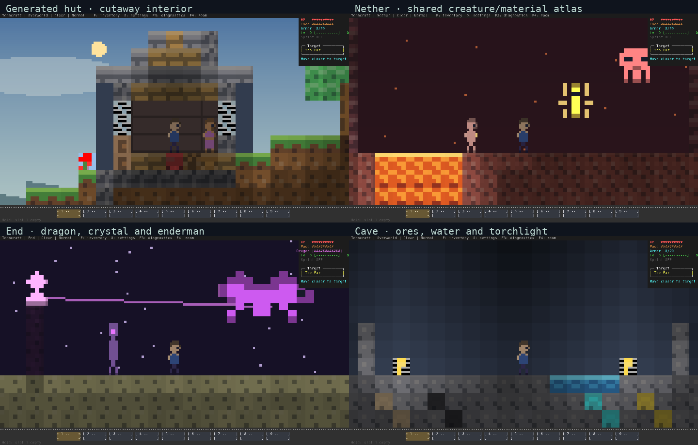
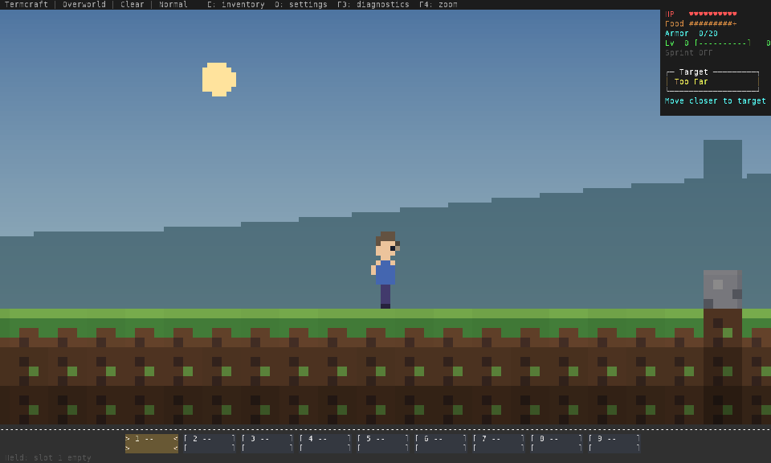

# Selected terminal pixel-art candidate

Captured on 11 October 2026, network protocol 10. These images show the implemented
renderer, not target illustrations or generated concept art. The exact native
binary and source hashes are in [the validation report](../../assets/pixel-refinement-2026-10-11.json).



- [Generated village hut](village.png): untouched procedural hut geometry from a
  disposable seeded Overworld, with its new roof and visual cutaway interior.
  Player/villager positions are staged for inspection. This is one hut, not a new
  multi-building village system.
- [Nether](nether.png): staged chamber, lava and existing pigman/blaze/ghast mobs.
- [End](end.png): staged existing dragon, crystal/beam, enderman and obsidian.
- [Cave](cave.png): staged stone, ores, water and torch illumination.

All scenes use the same material/creature atlas at 160×48 terminal cells. PNGs
convert real ANSI output into 9×18 cells, with half blocks drawn as exact pixel
rectangles and UI glyphs in DejaVu Sans Mono. Different terminal fonts, color
support and cell aspect ratios can change the result. The player and other mobs
are not scaled separately for these images. Scene staging edits disposable saves;
these captures are not evidence of a human survival playthrough.

## Physics-driven motion clip



The clip samples a real 48-tick physics run at three presentation samples per
20 Hz tick: walking right, jumping, releasing jump, reversing and stopping beside
blocks. [The authoritative position trace](motion.json) retains each tick.
The 144 source samples are resized to 960×576 using nearest-neighbor conversion.
GIF playback uses 20 ms per source frame (50 fps), so it is slower than the sampled
60 fps presentation. It demonstrates the rendering path; it is not a screen
recording, input-latency benchmark, human playtest or proof of jitter-free WAN play.

Recreate the ANSI scenes and trace from the repository:

```sh
env -u NO_COLOR cargo run --release --example pixel_review -- /tmp/termcraft-pixel-review
```

`examples/pixel_review.rs` constructs isolated seeds, finds a generated hut, runs
the course and removes its temporary save. The specified output directory keeps
ANSI captures and the trace. Use a fresh directory to avoid mixing runs.

See [the movement review](../../feel-and-art.md) for a human test route. The
[original three-style comparison](../visual-directions/index.html) predates this
refinement and remains historical design evidence.
