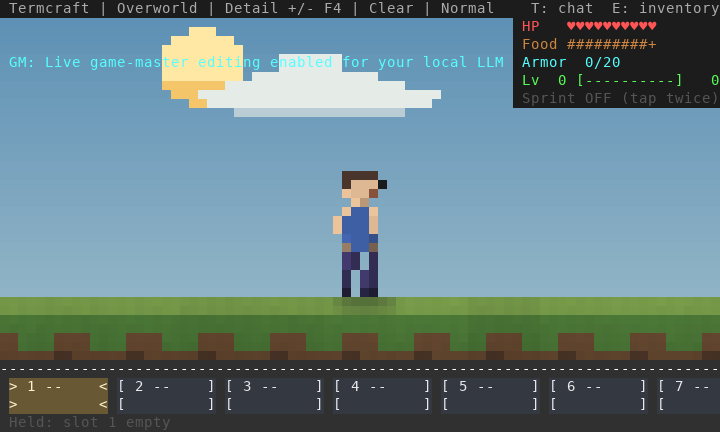
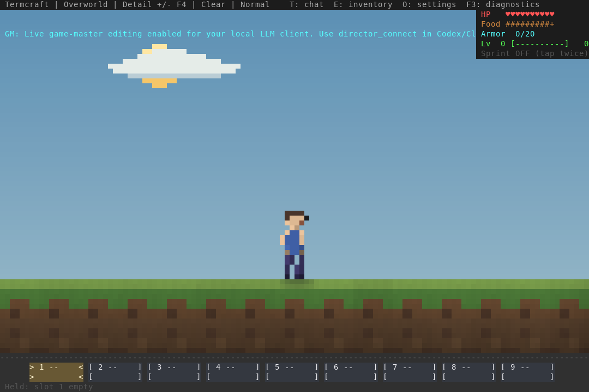
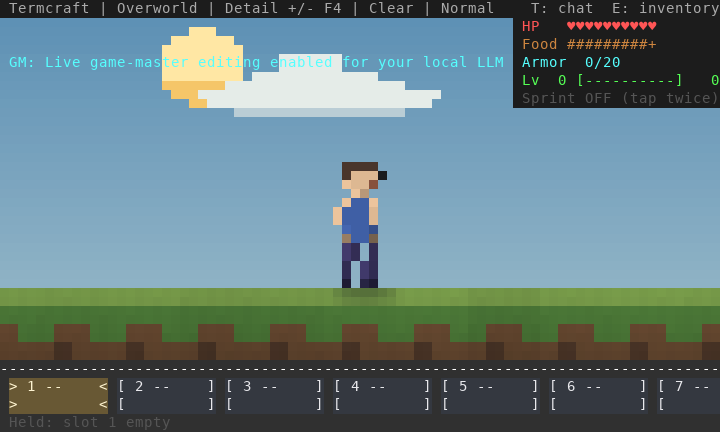
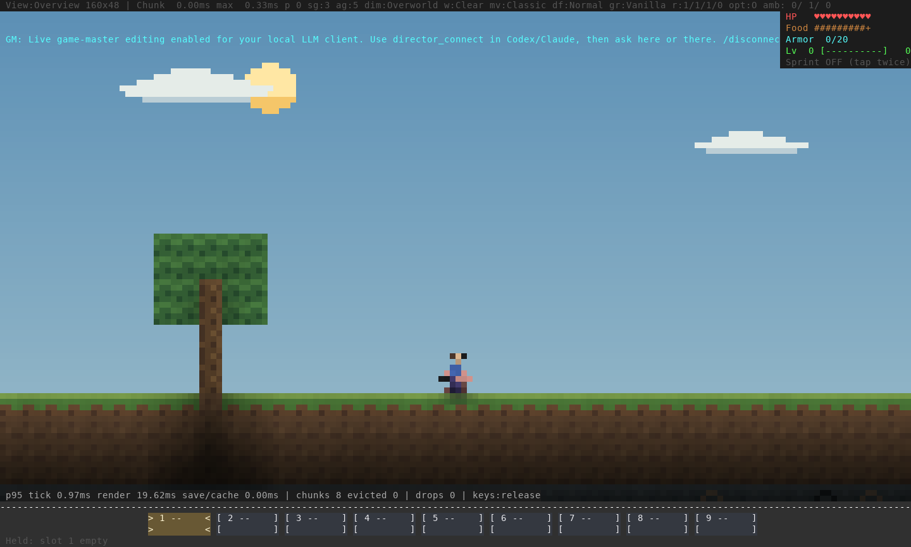

# Detail view, controls and frame pacing — 16 October 2026

The reported zoom reversal was real: enlarging a terminal font reduces the
terminal's column/row count, and hidden size gates then reduced the selected
sprite resolution. Detail also fell back to Overview during the End encounter.
Those gates are removed. Every selected color view now keeps its resolution;
compact windows show less world. Terminals smaller than 8×8 retain a safe resize
fallback. `NO_COLOR` remains an explicitly labelled glyph mode.

Implementation: [`031f66e`](https://github.com/pagel-s/termcraft/commit/031f66e616435ed60a293c3907b6fe2a8ccb5c29).
The updated local executable SHA256 is
`aa952c22d06a19aad1b4290c455760a3cb127380d6013cf8271ef083ee3e94b2`.
Network protocol 15, native checkpoint v9, server checkpoint v3 and chunk v2 are
unchanged. Existing worlds can be used after restarting the executable.

## What to try in Warp

- Hold A/D or an arrow to walk. Tap, release and quickly hold the same direction
  again to sprint. The HUD shows the state; release, reversal, sneak or food at
  three icons stops sprint. Shift holds sneak; X toggles sneak. Intentional
  double-tap sprint requires directional key-up events; repeat-only input cannot
  reliably identify that gesture.
- Press `=` once from the initial Overview to select Detail. `+` also zooms in;
  `-` zooms out. The header names Detail, Overview or Wide. F4 keeps the existing
  Overview → Wide → Detail cycle. Zooming the terminal font no longer reduces the
  selected artwork. Use Overview/Wide when an arena needs more context.
- Hold a direction, jump, release jump and keep moving, then release direction.
  Check both directions and abrupt reversal. F3 distinguishes `keys:release`
  from the conservative `keys:repeat` fallback.

These are real native and TCP co-op renderer captures following ordinary input
and PTY resizes, rasterized from ANSI output. No image generation or sprite
replacement was used. The cyan notification belongs to the automated test
observer. All four retained PNGs decode and were inspected.







## Movement and timing corrections

A legacy movement pulse can expire before the OS starts sending held-key repeats.
The old timeout retained its sprint tap window, so the first delayed repeat could
become an unintended second tap. Timeout/focus clears now reset pending sprint
taps, while actual directional releases retain the intentional gesture. Independent
fresh movement in the opposite direction is preserved.

Native and co-op rendering now consume the frame budget. Previously the loop
added a full frame sleep after rendering and terminal flushing. An 8 ms render
now leaves only the remainder of the 16.7 ms budget; a 40 ms render adds no further
frame sleep. Slow frames do not accumulate catch-up paint debt. Simulation keeps
its existing fixed 20 Hz step and bounded catch-up behavior.

Co-op F3 previously reported zero tick/render times. It now measures local
prediction and rendering/output, rather than server CPU or WAN delay.



The live PTYs measured native p95 tick 0.94–1.09 ms and render/output
17.73–19.62 ms; co-op local prediction was 0.04 ms and render/output
20.49–23.98 ms. Their Python screen decoder can backpressure the PTY. These are
fixture observations, **not Warp frame rates or input latency**; the histogram
also includes startup/resizing. The user's approximate 40 ms reading cannot be
assigned to a particular counter from that estimate alone.

The separate counting-writer profile covers ten scenes at 120×40 and 200×60,
210 frames per case. P95 renderer/ANSI CPU time is 0.42–2.69 ms locally. It excludes
kernel output, terminal presentation, simulation and networking. It does not
establish a speedup over an earlier release or smoothness on the user's hardware.

## Water and fixture correction

The prior [native run](https://github.com/pagel-s/termcraft/actions/runs/38919088235)
failed the native/shared water-route comparison on Windows and ARM Mac; Linux
and Intel Mac completed. Independently generated neighboring geometry could
enter that unbounded course. The course is now enclosed, retaining exact per-tick
position/velocity comparisons and the original tolerance.

Investigation also exposed a real hydraulic error: a high source's pressure
could cross dry air and affect an unrelated low pool. Source heads now follow wet
connections and one dry growth neighbor, without traversing unfilled air.
Connected vessels, filling, outlets, drainage and real source pickup/reopen remain
checked. The source-fed model's volume, unloaded-edge and waterlogging limits in
the [basin review](../water-basins-2026-10-16/README.md) remain applicable.

The terminal movement test also now walks to the clear western runway before
checking landing height. A zero-relief recipe intentionally includes the starter
tree at x=10; landing on its geometry was not a flat-ground landing test. Ordinary
input stages this setup, with no live world/player edits. The production tree is
unchanged.

## Verification and evidence

- All **748 unit tests** pass on stable Rust and Rust 1.88. Strict all-target
  Clippy passes on both, as do formatting and Python compilation.
- All **six real TCP/process tests** pass. Native/co-op terminal input checks cover
  initial legacy taps, delayed OS repeat, held movement, jump chords, continuing
  after jump release, direction release, focus loss and intentional sprint.
  Wall-clock sprint distances exceed walking in both; the simulation's nominal
  multiplier is 1.3. PTY scheduling affects measured distances.
- The separate native/co-op view check retains Detail through 160×48 → 120×40 →
  80×24 → 160×48. Direct zoom, saturation and the existing F4 cycle pass. Moving
  co-op render diagnostics are nonzero. Both harnesses join automatic Linux CI;
  their observations never edit game state.
- The native fluid fixture passes actual bucket placement/pickup, source height,
  connection, overflow, drain/refill and partial/full save/reopen checks. Lantern
  Run completes through normal rules and retains progress on reopen.
- The optimized build and offline crate package/verification pass. Strict MkDocs
  validation is recorded in `evidence.json`.

`before-detail.log`, `before-repeat.log` and `before-pressure.log` record the new
reproductions failing before their respective fixes. They are targeted working-tree
reproductions, not a complete baseline suite or an old/new performance benchmark.
Final reports, source hashes and log summaries are in `evidence.json`,
`terminal-input.json`, `terminal-views.json`, `fluid-checks.json`, `lantern-run.json`
and `render-profile.json`.

The [new native matrix](https://github.com/pagel-s/termcraft/actions/runs/38930245714)
and [general CI](https://github.com/pagel-s/termcraft/actions/runs/38930245503)
are in progress at evidence collection. Pending jobs are not qualified by local
Linux results. Human Warp feel, native terminal behavior on each OS, sustained
human co-op/WAN play and the full survival campaign remain release gates.

## Reproduce

```sh
cargo test --locked
cargo clippy --all-targets --locked -- -D warnings
cargo test --locked --test multiplayer_tcp -- --ignored
cargo build --release --locked --bin termcraft --example fluid_review --example render_profile
python3 scripts/test_terminal_input.py --binary target/release/termcraft --report /tmp/input.json
python3 scripts/test_terminal_views.py --binary target/release/termcraft --report /tmp/views.json --keep-artifacts
python3 scripts/test_lantern_trial.py --binary target/release/termcraft --report /tmp/lantern.json
env -u NO_COLOR target/release/examples/render_profile > /tmp/render-profile.json
```

The PTY scripts require Unix and Pillow. Rust tests and native builds are qualified
separately on Linux, Windows and both Mac architectures by the automatic matrix.
