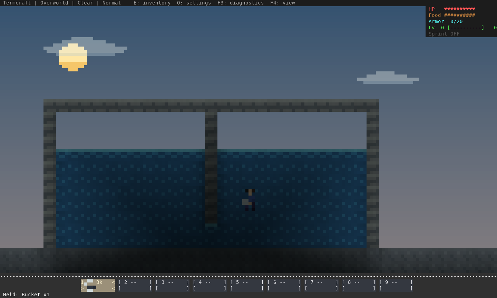
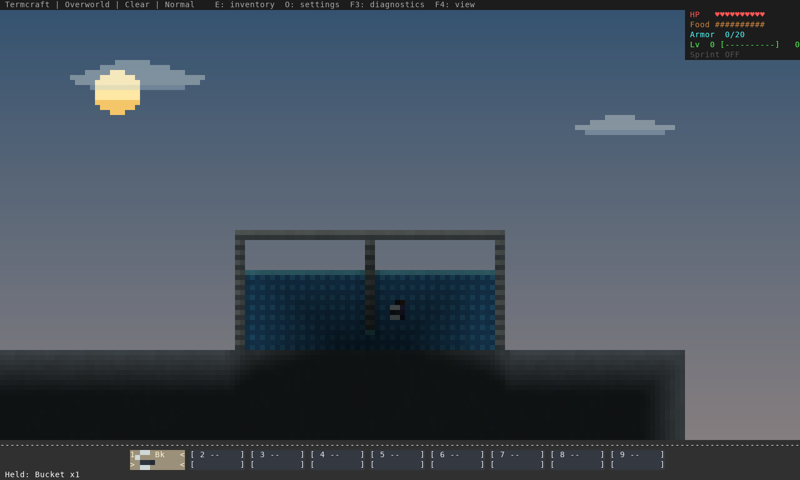
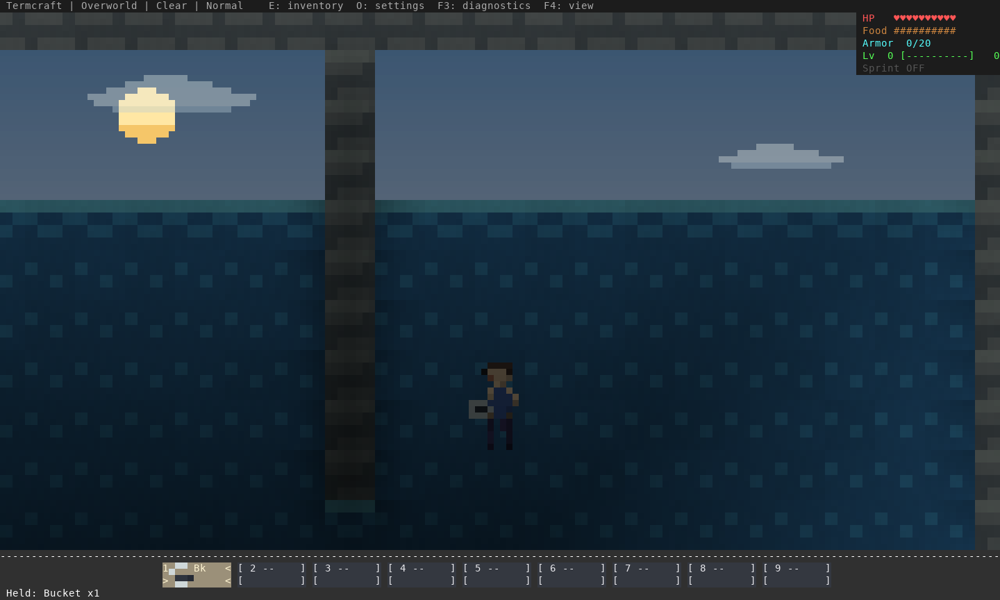
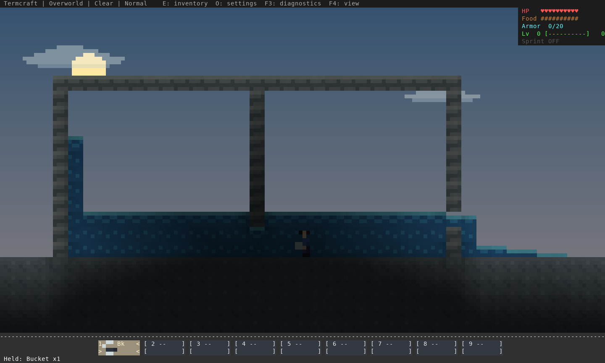
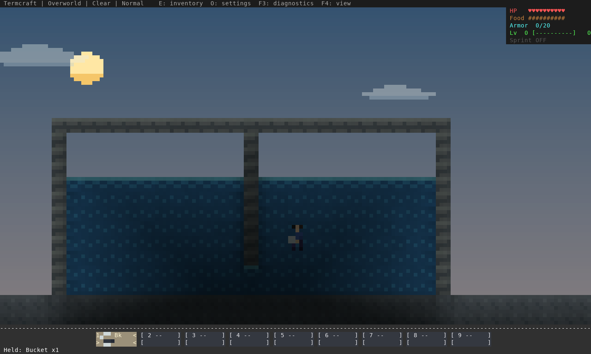
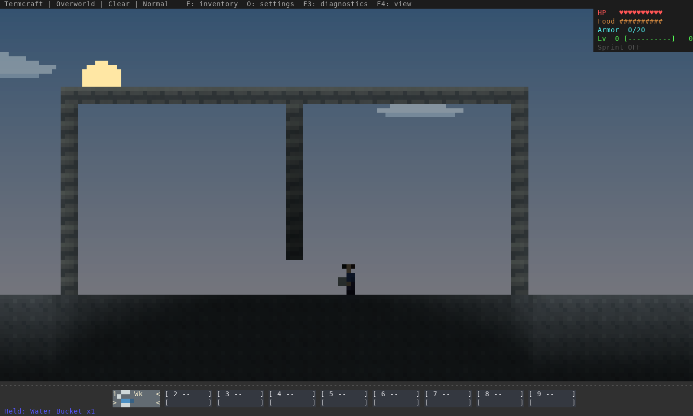

# Source-height water and connected basins — 16 October 2026

Water now fills a contained basin toward its source's surface and rises on the
other side of a submerged passage. The previous seven-block stream solver could
not do either: both new reproductions fail before this change (`before-tests.log`).

Implementation: [`f8aac31`](https://github.com/pagel-s/termcraft/commit/f8aac31ed286650df244bf47cc8017614e2e2c2e).
The installed executable SHA256 is
`046ddbda16b32ffd978d46cbde0184d99e2f6e8a07e45034c9a6d378edc69e65`.

## How water behaves

- Contained water fills from the bottom and reaches its source surface, including
  through low tunnels. It cannot rise above the source or cross a solid wall.
  Basin filling extends beyond the short runoff range.
- Each pool's lowest escape crest limits its level. A shallow overflow layer
  carries water across the rim into the next terrace. Opening a side drain lowers
  the pool; closing it lets the source refill it.
- Waterfalls stay vertical until landing. Uncontained runoff still prefers a
  nearby drop and tapers over seven cells. Lava retains its existing reach,
  slower Overworld/End cadence and water-contact cooling rules.
- Full supplied water is `Water(9)`, distinct from a persistent `Water(8)` source.
  Filled cells do not become independent sources. Collecting the sole source or
  sealing off its supply makes the supplied pool recede. Two actual sources can
  still regenerate their supported gap; natural pools can contain many sources.
- Snapshot evaluation and sorted application keep results independent of chunk
  insertion order. The hydraulic calculation uses resident geometry, including
  outside the ticking window. Distant co-op regions are processed separately;
  the solver does not allocate or generate the space between players.
- Settled pools leave the active frontier. Rendering, immersion, breathing and
  buoyancy use the same full surface for supplied water and sources.

This preserves source-fed game rules. It does **not** conserve finite water volume
after a source is collected or isolated. Unknown/unloaded chunk edges act as
outlets, so pressure is not solved across an arbitrarily distant unloaded world.
Waterlogged slabs/stairs, physical currents and fluid-driven boat drift remain
outside this implementation. Doors retain their existing fluid-blocking rules in
both states.

Chunk payload v2, native checkpoint v9 and server checkpoint v3 remain compatible
with existing saves. Full supplied water saves/reopens in the existing fluid byte.
Network protocol is now **15**: use matching clients/server. No fresh world is
required. Existing flows re-evaluate as their loaded area simulates.

## Rendered checks

These are actual terminal-renderer captures from disposable native saves, with
staged geometry/player poses and real bucket use commands/world ticks. The roof
supports a divider ending two blocks above the floor; that low opening connects
the two vessels. Water is level on both sides, below the roof and source limit.







Opening the right outlet lowers both vessels while the source continues falling
down the left side. The shallow outlet spills onto the outside floor.





Collecting the actual source with a bucket removes its supply; the filled water
recedes, exposing the passage under the supported divider.



Ten scenarios render at all three color views; all 30 PNGs decode successfully.
The retained views above were visually inspected, alongside waterfall/runoff and
lava captures. `captures.json` identifies the generated images. These staged
captures do not establish human swimming feel or terminal presentation latency.

## Verification

All **742 unit tests** pass on stable Rust and Rust 1.88. Strict all-target Clippy
passes on both. The suite covers wide/deep basins, source-height limits,
communicating vessels, terraces, drain opening/closure, source removal/isolation,
wall/door barriers, chunk seams, reversed insertion order, tick-window movement,
unknown edges and distant co-op regions. Existing waterfall, runoff, lava/mixing,
crop drops, source regeneration and physics checks remain passing. Full supplied
water is included in rendered-depth, immersion and boat-surface checks.

All **six real TCP/MCP tests** pass. The new test lets the server fill a basin
across a chunk seam, verifies full supplied water on both clients, restarts the
server, collects the source through an ordinary bucket command, and verifies
drainage on both clients and after reopening the saved world.

The native fixture saves a partially filled vessel, reopens and completes it,
saves/reopens the full supplied water, opens/closes an outlet, and collects the
source with a bucket. It also checks waterfalls, runoff, nearby drains and lava.
`checks.json` records results and CPU-only timings, which include settled ticks
and exclude rendering, storage and WAN latency; they are not FPS measurements.

Native/co-op PTYs pass running, jumping, continued movement after jump release,
key release, focus loss and terminal restoration. Lantern Run completes through
normal rules and preserves progress on reopen. Their reports retain the tested
binary hash. Offline crate verification and strict documentation build also pass.

The new automatic general/native-platform workflows are still running in
`ci-at-verification.json`. Previous fluid-source native CI completed successfully;
that result does not qualify the new pending jobs. Human swimming, shoreline exits,
boats, terminal/OS feel and the full survival campaign remain release gates.

## Reproduce

```sh
cargo test --locked
cargo clippy --all-targets --locked -- -D warnings
cargo test --locked --test multiplayer_tcp -- --ignored
cargo build --release --locked --bin termcraft --example fluid_review
env -u NO_COLOR target/release/examples/fluid_review /tmp/termcraft-basin-ansi
python3 scripts/capture_terminal_art.py /tmp/termcraft-basin-ansi /tmp/termcraft-basin-png
```

In a playtest copy, dig a basin, pour a bucket against its wall and wait for the
surface to rise to the source. Connect a second basin through a low tunnel: its
surface should rise to the same height. Open a lower side outlet, then close it.
Check lowering/refill, swimming and bank exits, collect the original source, and
save/reopen. Repeat in co-op with matching protocol-15 builds and compare F4 views.
