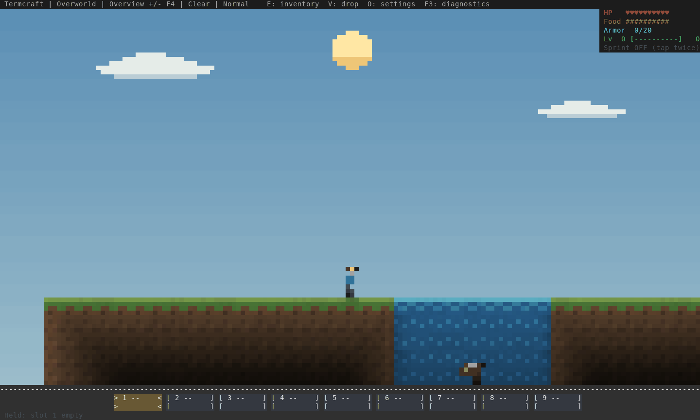
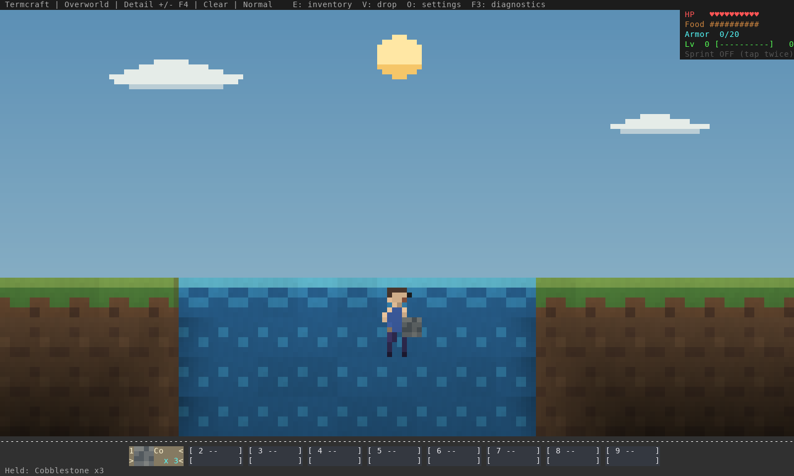
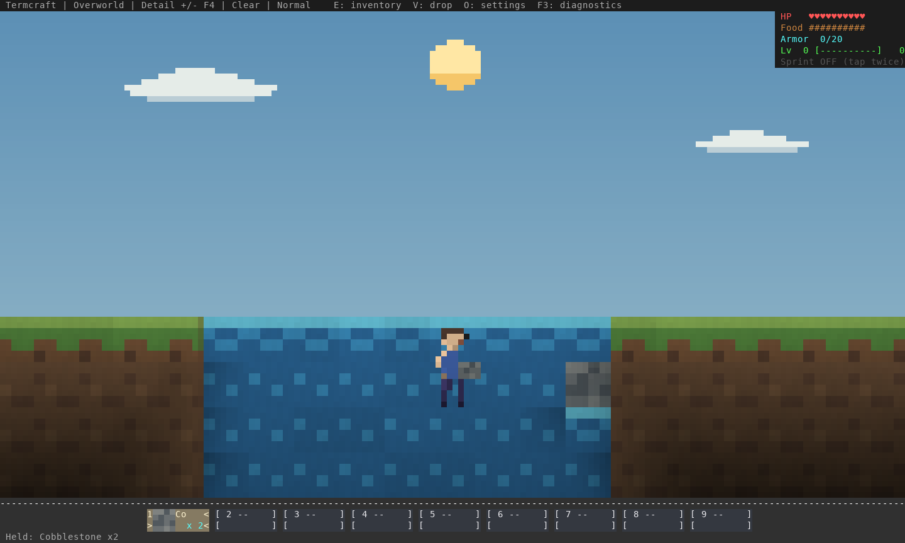

# Building and animal survival in water

## Swimming and shore avoidance



The staged cow starts submerged near the pond floor. Normal engine ticks move
it toward air, then out onto a bank. Its health stays full. The view is Overview
so the whole pond, bottom and both shores fit on screen.

Cows, sheep, pigs, chickens, wolves and ocelots now paddle up and steer toward
a nearby bank. On land they turn before walking/hopping into water or lava.
Solid paths over buried water remain usable. Hurt impulses still use ordinary
physics; swimming does not cancel knockback or remove drowning damage.

This is local steering, not navigation across an entire river system: the bank
search checks up to 12 loaded columns per side and up to 16 cells toward the
surface. Animals can still drown under a sealed roof or when no air is reachable.
Squid and hostile creature movement is unchanged.

## Building into water

Before a normal `UseAt(3, 16)` action:



After: one cobblestone block replaces water at the reachable bank; the held
stack decreases from three to two:



Directly selected water beside a support remains replaceable. When the selected
water cell has no support, a solid building block now aims through the water to
the nearest submerged face within the normal 4.5-block reach. This makes it
possible to build against a submerged bank/floor without selecting an exact face
behind the water. Unsupported floating placement and building inside either
player remain rejected. Water continues flowing around placed solid blocks.

## Checks and reproduction

Nine regression tests cover all six land-animal families leaving a deep pond,
raised banks in both directions, water/lava avoidance, ordinary paths over water, player-input independence,
knockback, drowning under a roof, source/flow replacement, backing reach,
inventory consumption and protection of another player's occupied cell.

The full library suite passes **822** tests on stable Rust and MSRV 1.88.0,
with strict Clippy on both. All seven existing real TCP tests also pass, including
water replication, drain/reopen behavior and multiplayer building.

[Evidence](evidence.json) records the exact binary/source hashes, every captured
ANSI frame, the cow's position/air/health on each tick and image hashes. The pond,
animal and inventory are staged; movement, placement and rendering use actual
game code. These are automated checks, not manual Warp acceptance.

```sh
cargo build --release --bin termcraft --example water_review
env -u NO_COLOR target/release/examples/water_review /tmp/water-review
python3 scripts/build_water_review.py --captures /tmp/water-review \
  --binary target/release/termcraft --output /tmp/water-gallery
```

Existing saves use these changes immediately; no world regeneration or save
format change is required.
