# Termcraft block and state comparisons

All 97 samples, captured through the actual renderer. Select an image to enlarge it.

[World gallery](../world-atlas-2026-10-15/README.md) · [Review notes and ore census](provenance.md)

| Block/state | Before | Current | Detail |
| --- | --- | --- | --- |
| `Dirt` |  |  | [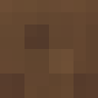](block-000-detail.png) |
| `Grass` |  | [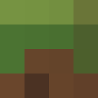](block-001-now.png) | [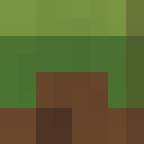](block-001-detail.png) |
| `Stone` |  |  |  |
| `Wood` |  |  |  |
| `Leaves` |  |  |  |
| `IronOre` |  |  |  |
| `GoldOre` |  |  |  |
| `DiamondOre` | [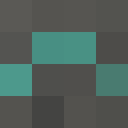](block-007-before.png) |  |  |
| `CoalOre` |  |  |  |
| `Sand` |  |  |  |
| `Gravel` |  | [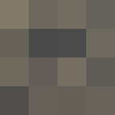](block-010-now.png) | [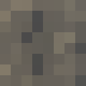](block-010-detail.png) |
| `Bedrock` |  |  |  |
| `Planks` |  |  |  |
| `CraftingTable` |  |  |  |
| `Torch` |  |  |  |
| `Lever(false)` |  |  | [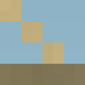](block-015-detail.png) |
| `Lever(true)` |  |  |  |
| `StoneButton(0)` |  |  |  |
| `StoneButton(4)` |  |  |  |
| `RedstoneTorch(false)` |  |  |  |
| `RedstoneTorch(true)` |  |  |  |
| `Furnace` | [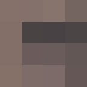](block-021-before.png) | [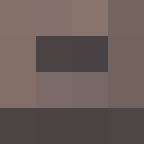](block-021-now.png) |  |
| `Snow` |  | [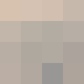](block-022-now.png) |  |
| `Ice` |  |  |  |
| `Cactus` |  |  | [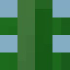](block-024-detail.png) |
| `DeadBush` |  |  |  |
| `BirchWood` |  |  |  |
| `BirchLeaves` |  |  | [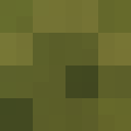](block-027-detail.png) |
| `RedFlower` |  |  |  |
| `YellowFlower` |  |  |  |
| `TallGrass` |  |  |  |
| `Water(1)` |  |  |  |
| `Water(4)` |  |  |  |
| `Water(8)` |  |  |  |
| `Lava(1)` |  |  |  |
| `Lava(4)` |  |  |  |
| `Lava(8)` |  |  |  |
| `Cobblestone` |  | [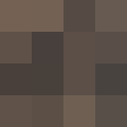](block-037-now.png) | [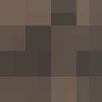](block-037-detail.png) |
| `Obsidian` |  |  |  |
| `Farmland(0)` |  |  |  |
| `Farmland(7)` |  |  |  |
| `Crops(0)` |  |  |  |
| `Crops(3)` |  |  |  |
| `Crops(7)` |  |  |  |
| `RedstoneOre` |  |  |  |
| `RedstoneDust(0)` |  |  |  |
| `RedstoneDust(7)` |  |  |  |
| `RedstoneDust(15)` |  |  |  |
| `Netherrack` |  |  | [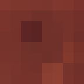](block-048-detail.png) |
| `SoulSand` |  |  |  |
| `Glowstone` |  |  |  |
| `NetherPortal` |  |  |  |
| `Tnt` |  |  |  |
| `PrimedTnt(1)` |  |  |  |
| `PrimedTnt(4)` |  |  |  |
| `Piston { extended: false, facing_right: false }` |  |  |  |
| `Piston { extended: false, facing_right: true }` |  |  | [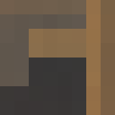](block-056-detail.png) |
| `Piston { extended: true, facing_right: false }` |  |  |  |
| `Piston { extended: true, facing_right: true }` |  |  |  |
| `StickyPiston { extended: false, facing_right: false }` |  |  |  |
| `StickyPiston { extended: false, facing_right: true }` |  |  |  |
| `StickyPiston { extended: true, facing_right: false }` |  |  |  |
| `StickyPiston { extended: true, facing_right: true }` |  |  |  |
| `StoneBricks` |  |  | [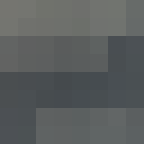](block-063-detail.png) |
| `EndPortalFrame { filled: false }` | [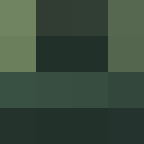](block-064-before.png) |  | [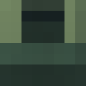](block-064-detail.png) |
| `EndPortalFrame { filled: true }` |  |  | [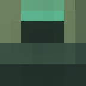](block-065-detail.png) |
| `EndPortal` |  |  |  |
| `EndStone` | [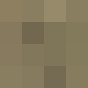](block-067-before.png) |  | [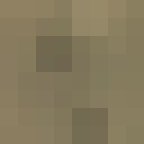](block-067-detail.png) |
| `IronDoor(false)` |  |  |  |
| `IronDoor(true)` |  |  |  |
| `SilverfishSpawner` |  |  |  |
| `Bed` |  |  |  |
| `Chest` |  |  | [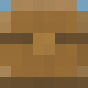](block-072-detail.png) |
| `Glass` |  |  |  |
| `WoodDoor(false)` |  |  |  |
| `WoodDoor(true)` |  |  |  |
| `Ladder` |  | [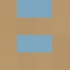](block-076-now.png) | [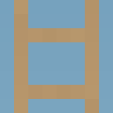](block-076-detail.png) |
| `StoneSlab` |  |  |  |
| `StoneStairs` |  |  |  |
| `EnchantingTable` |  |  |  |
| `Anvil` |  |  |  |
| `BrewingStand` |  |  | [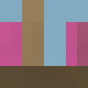](block-081-detail.png) |
| `BlazeSpawner` |  |  |  |
| `RedstoneRepeater { powered: false, delay: 2, facing_right: false, timer: 0, target_powered: false }` |  |  | [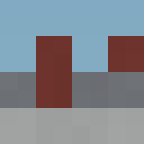](block-083-detail.png) |
| `RedstoneRepeater { powered: false, delay: 2, facing_right: true, timer: 0, target_powered: false }` |  |  | [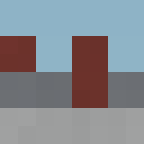](block-084-detail.png) |
| `RedstoneRepeater { powered: true, delay: 2, facing_right: false, timer: 0, target_powered: true }` |  |  |  |
| `RedstoneRepeater { powered: true, delay: 2, facing_right: true, timer: 0, target_powered: true }` |  |  |  |
| `Wool` | [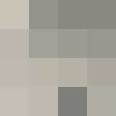](block-087-before.png) | [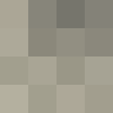](block-087-now.png) |  |
| `Sapling` |  |  |  |
| `SugarCane` |  |  | [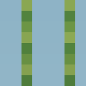](block-089-detail.png) |
| `Bookshelf` |  |  | [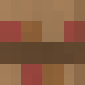](block-090-detail.png) |
| `NetherWart(0)` |  |  |  |
| `NetherWart(1)` |  |  |  |
| `NetherWart(3)` |  |  |  |
| `BirchSapling` |  |  |  |
| `ZombieSpawner` |  |  |  |
| `SkeletonSpawner` |  |  |  |
